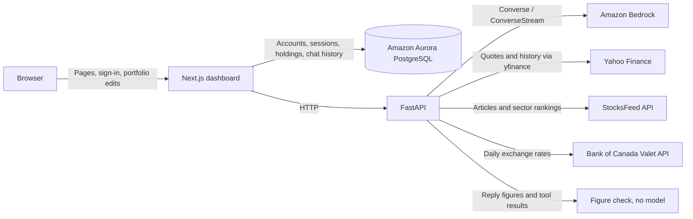

# How the datathon template works

The template runs two apps. Next.js renders the dashboard and owns user accounts and portfolios. FastAPI supplies the quotes, charts, and news that users see alongside their holdings. Opening Home brings those two sets of data together.

## Sign-in and portfolios

Visiting `/` opens `/dashboard/home`. The [Next.js proxy](frontend-dashboard/src/proxy.ts) checks the Better Auth session for dashboard requests and sends signed-out users to the login page. Account settings, including name and password changes, use the same Better Auth service inside Next.js.

When someone adds a stock, the picker searches the [local S&P 500 list](frontend-dashboard/src/data/sp500.ts). The [server action](frontend-dashboard/src/server/add-portfolio-stock.ts) gets the user ID from the session, validates the ticker and optional share count, and writes to Aurora. The [portfolio table](frontend-dashboard/src/scripts/create-portfolio-table.ts) has one row per user and ticker. A positive decimal records shares held. A blank share count is stored as SQL `NULL`, so users can follow a stock without entering a position size.

After a successful edit, Next.js refreshes the dashboard. The sidebar and Home use the [same holdings query](frontend-dashboard/src/server/portfolio.ts), scoped to the signed-in user. Quotes come from FastAPI when the page renders.

## Finance chat

Chat can compare named stocks using the same Yahoo price-history period or discover companies using the Home page’s StocksFeed most-mentioned ranking. A combined request compares price returns only among the companies in the returned coverage ranking.

The dashboard's [chat route](frontend-dashboard/src/app/api/finance-chat/route.ts) checks the Better Auth session and loads the signed-in user's last ten completed exchanges in the selected thread from Aurora. It posts those exchanges and the new question to FastAPI’s authenticated `POST /chat/stream` route. FastAPI uses Bedrock ConverseStream and returns lookup results with their Bedrock tool-use IDs so subsequent lookups can depend on them. It executes requested lookups and forwards answer text as newline-delimited JSON. The backend also emits tool start and finish events. The dashboard shows these in an expandable timeline and saves the steps with the completed turn. OpenUI renders partial replies as text arrives. The stock-page action uses the JSON endpoint to create its initial explanation before redirecting. The dashboard attaches holdings from the session-scoped portfolio query. When Bedrock requests `get_my_portfolio`, FastAPI uses those holdings to report quantities, retrieve Yahoo Finance quotes for valuation, or find StocksFeed coverage. The dashboard saves the returned portfolio snapshot alongside the answer and renders the same breakdown when the thread reopens. Valuations exclude watchlist entries and group priced positions by currency. Chart threads also send the saved price summary as reference data. After the completion event arrives, the route stores the question and reply in a single row in `chat_turns`. A turn number scoped to the user and thread prevents concurrent submissions from appending replies based on stale history. FastAPI instructs Sonnet to return a complete OpenUI FinanceAnswer with prose and an optional table. The dashboard validates its arguments and renders source links appended by the backend separately. Legacy Markdown (including pipe tables) and earlier comparison replies remain readable. Aurora stores the original reply so the same view can reopen from history. The dashboard uses the OpenUI chat provider to select and resume conversations. The dashboard sidebar lists the signed-in user’s threads by recent activity. A thread link opens its history directly, and New chat opens an empty conversation. A thread is persisted with its first completed exchange, titled from its first question, and listed by most recent activity. The chat migration preserves each account’s earlier turns together in a single thread.

On a stock page, **Explain this chart** opens a new thread using the exact quote and closing-price candles that rendered the selected period. The dashboard calculates the percentage move against the same baseline as the stock page (previous close for 1d, first candle close otherwise) and the largest move between adjacent candle closes. The original points and summary are saved with the first turn in `chat_turns.chart_snapshot`. Finance chat exposes a read-only `search_news` tool to Bedrock. A natural-language request can filter StocksFeed by ticker, topic and time window (up to 30 days), or retrieve broad market coverage. The chart’s **Show related news** button uses the same flow with the saved ticker. FastAPI executes each requested stock lookup in the turn and saves all successful stock snapshots for chart rendering and follow-ups. News searches in the same turn share a deduplicated numbered source list. Each search supplies up to three distinct articles and their summaries to Sonnet, then appends publisher links and publication dates to the answer. The dashboard saves the underlying news snapshot with that turn in Aurora and sends the most recent snapshot from the same thread on follow-ups, preserving source order after refresh.

Portfolio "what if" questions use the calculation tools in [`app/modules/analysis`](backend-server/app/modules/analysis/tools.py), registered in the same Bedrock tool loop. `simulate_transfer` moves a share of the whole portfolio's value from one holding to another and returns weights, sector exposure and concentration before and after in one call. `sector_exposure`, `concentration`, `risk_history`, `check_data` and `convert_currency` answer the same kinds of question for the current or a hypothetical portfolio. `portfolio=mine` uses the session-scoped holdings and converts their values to CAD with the latest Bank of Canada rate, so weights cover every currency. `portfolio=hypothetical` uses weights stated in the question and is labeled as such. Sector shares come from Yahoo Finance fund sector weights or a company's sector; holdings without a profile are reported as unclassified. `risk_history` uses daily closes adjusted for splits and dividends, keeps only the trading dates common to all symbols, and always includes the coverage check. All figures come from pure functions in [`calculations.py`](backend-server/app/modules/analysis/calculations.py); Bedrock only chooses the tools and explains their results.

After the reply text has streamed, FastAPI checks every figure in it against the results of the tools called for that question. The check lives in [`app/modules/verification`](backend-server/app/modules/verification/checks.py) and uses no model. The route keeps each tool call's result in an evidence ledger, then reads the `FinanceAnswer` title, explanation, headers and rows. It looks each figure up in the tool results (not those of failed calls), the user's question and the saved reference data sent with it (chart, previous stock and news, earlier exchanges). Rounding to the displayed precision, French and English number formats, signs, units and currencies are taken into account. A figure with no source makes the verdict `rejected`. A figure that is only a change between a tool's `before` and `after` values, a gap in points, or simple arithmetic on the question's numbers gives `review`, as do bare small whole numbers with no source. The verdict is sent as a `verify_answer` step in the same activity stream as the tools, with the figures that failed or were computed, and the dashboard saves it in `chat_turns.tool_activity`, so reopened threads show it. The check is advisory: if it fails the reply is still delivered, and the verdict is `unverified`. Replies saved before this check have no such step.

Direct stock questions use a read-only `get_stock` tool on FastAPI. It reuses the Yahoo Finance history service and calculates price change and observed highs and lows from the selected period. For performance questions, Aurora also saves the fetched closing-price points in the stock snapshot. OpenUI renders the shared stock-page chart below the takeaway using those points. Month to date uses the exchange-local calendar month and prior month close; a trailing month uses the first returned candle close. Quote-only lookups omit the chart. Aurora stores the stock summary alongside the answer. Follow-ups receive the most recent stock snapshot from the signed-in user’s thread. Requests for an updated price or a different period trigger a new lookup.

## Prices, news, and Discover

| What the user opens | FastAPI request | Where the result comes from |
| --- | --- | --- |
| A stock chart | `GET /stock/{ticker}/history?period=1mo` | yfinance fetches Yahoo Finance data for the selected period. One response includes the latest regular-market quote and historical candles. |
| A stock or portfolio news feed | `GET /articles?tickers=AAPL,MSFT` | StocksFeed returns matching articles. The endpoint also accepts time, sector, search, and sentiment filters. |
| Article details by slug | `GET /article/{article_slug}` | StocksFeed returns the matching article or a null article. |
| Discover on Home | `GET /stocks/most-mentioned?sector=Technology` | StocksFeed ranks S&P 500 stocks by distinct articles over the past 24 hours by default. The sector filter uses the company's sector. |

The [stock history fetcher](frontend-dashboard/src/server/stock-history.ts) converts share-class symbols such as `BRK.B` to Yahoo's `BRK-B` and requests the quote with `cache: "no-store"`. The chart reads `history.candles` and uses Unix seconds for time. The latest price comes from `history.ticker.regularMarketPrice`. A missing ticker or period with no market data can return 404. Yahoo rate limiting returns 503.

Discover fetches the ranking with a 60-second revalidation interval. It uses the quote endpoint separately to display each company's price and daily change. StocksFeed owns article collection and analysis. To build a datathon-specific news source, start with the [StocksFeed integration](backend-server/app/integrations/stocksfeed/service.py). It is the point where the template makes outbound HTTP requests and checks the returned data. The news routes report upstream failures as HTTP 502.

## Running the pieces together

Start FastAPI on port 8000 and Next.js on port 3000 in separate terminals. The dashboard reads `BACKEND_API_URL` from its server environment. FastAPI reads `STOCKSFEED_BASE_URL` from its own environment. Aurora connection settings and the Better Auth secret belong in the dashboard's server environment.

For a fresh database, run the authentication migration before the portfolio migration because holdings reference the Better Auth user table. See the [dashboard setup](frontend-dashboard/README.md#run-locally) for the commands and the [backend README](backend-server/README.md) for Python setup, supported chart periods, and example requests.
