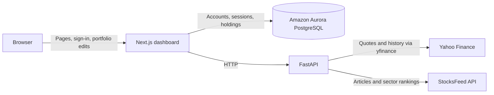

# How the datathon template works

The template runs two apps. Next.js renders the dashboard and owns user accounts and portfolios. FastAPI supplies the quotes, charts, and news that users see alongside their holdings. Opening Home brings those two sets of data together.

## Sign-in and portfolios

Visiting `/` opens `/dashboard/home`. The [Next.js proxy](frontend-dashboard/src/proxy.ts) checks the Better Auth session for dashboard requests and sends signed-out users to the login page. Account settings, including name and password changes, use the same Better Auth service inside Next.js.

When someone adds a stock, the picker searches the [local S&P 500 list](frontend-dashboard/src/data/sp500.ts). The [server action](frontend-dashboard/src/server/add-portfolio-stock.ts) gets the user ID from the session, validates the ticker and optional share count, and writes to Aurora. The [portfolio table](frontend-dashboard/src/scripts/create-portfolio-table.ts) has one row per user and ticker. A positive decimal records shares held. A blank share count is stored as SQL `NULL`, so users can follow a stock without entering a position size.

After a successful edit, Next.js refreshes the dashboard. The sidebar and Home use the [same holdings query](frontend-dashboard/src/server/portfolio.ts), scoped to the signed-in user. Quotes come from FastAPI when the page renders.

## Prices, news, and Discover

| What the user opens | FastAPI request | Where the result comes from |
| --- | --- | --- |
| A stock chart | `GET /stock/{ticker}/history?period=1mo` | yfinance fetches Yahoo Finance data for the selected period. One response includes the latest regular-market quote and historical candles. |
| A stock or portfolio news feed | `GET /articles?tickers=AAPL,MSFT` | StocksFeed returns matching articles. The endpoint also accepts time, sector, search, and sentiment filters. |
| Article details by slug | `GET /article/{article_slug}` | StocksFeed returns the matching article or a null article. |
| Discover on Home | `GET /stocks/most-mentioned?sector=Technology` | StocksFeed ranks S&P 500 stocks by distinct articles over the past 24 hours by default. The sector filter uses the company's sector. |

The [stock history fetcher](frontend-dashboard/src/server/stock-history.ts) converts share-class symbols such as `BRK.B` to Yahoo's `BRK-B` and requests the quote with `cache: "no-store"`. The chart reads `history.candles` and uses Unix seconds for time. The latest price comes from `history.ticker.regularMarketPrice`. A missing ticker or period with no market data can return 404. Yahoo rate limiting returns 503.

Discover fetches the ranking with a 60-second revalidation interval. It uses the quote endpoint separately to display each company's price and daily change. StocksFeed owns article collection and analysis. To build a datathon-specific news source, start with the [StocksFeed integration](backend-server/app/integrations/stocksfeed/service.py). It is the point where the template makes outbound HTTP requests and checks the returned data. The news routes report upstream failures as HTTP 502.

## Running the pieces together

Start FastAPI on port 8000 and Next.js on port 3000 in separate terminals. The dashboard reads `BACKEND_API_URL` from its server environment. FastAPI reads `STOCKSFEED_BASE_URL` from its own environment. Aurora connection settings and the Better Auth secret belong in the dashboard's server environment.

For a fresh database, run the authentication migration before the portfolio migration because holdings reference the Better Auth user table. See the [dashboard setup](frontend-dashboard/README.md#run-locally) for the commands and the [backend README](backend-server/README.md) for Python setup, supported chart periods, and example requests.
