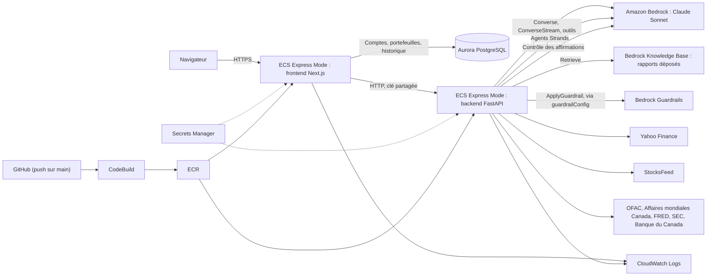

# Documentation technique : PolyFinances AlphaForge (RiskRipple)

> **Brouillon.** Les passages marqués **[À COMPLÉTER]** attendent un chiffre ou une vérification faite sur le prototype déployé. Aucun chiffre de performance n'est inventé ici.

Datathon PolyFinances 2026. Équipe : Sami Mostfa, Pacifique Uwamukiza, Benjamin Ollomo, Mohamed Oubagha.
Simulation seulement : aucune transaction réelle, aucun conseil financier personnalisé.

## 1. Résumé

AlphaForge est un outil d'aide à la décision d'investissement. Il répond à deux questions :

1. **Chat financier et BreakPoint AI.** « Que change ce scénario pour mon portefeuille ? » (par exemple le transfert de 10 % vers un fonds technologique).
2. **RiskRipple.** « Cette sanction, cette réglementation ou cette actualité touche-t-elle mes titres, directement ou par un fournisseur, un matériau ou un client ? »

Le principe de conception est unique : **le code calcule, le modèle explique, un contrôle vérifie.** Les poids, la concentration, l'exposition sectorielle, la volatilité et les baisses maximales viennent de fonctions Python reproductibles. Amazon Bedrock choisit les outils et rédige l'explication. Un vérificateur compare ensuite chaque chiffre de la réponse aux résultats des outils.

## 2. Architecture

Sources : [`ARCHITECTURE.md`](../ARCHITECTURE.md) pour le détail du chat et des routes, [`roadmap/ROADMAP-DEPLOIEMENT.md`](../roadmap/ROADMAP-DEPLOIEMENT.md) pour le déploiement.

| Couche | Technologie | Rôle |
|---|---|---|
| Frontend | Next.js 16, React 19, Better Auth, OpenUI | Pages, connexion, portefeuilles, chat en flux continu, pages RiskRipple |
| Backend | FastAPI (Python 3.12) | Outils de calcul, routes de chat, enquêtes et alertes RiskRipple, vérification |
| Base de données | Amazon Aurora PostgreSQL | Comptes, sessions, portefeuilles, historique des conversations, alertes |
| IA | Amazon Bedrock, Strands Agents | Chat, recommandations d'alertes, agents d'enquête |
| Données publiques | Yahoo Finance, StocksFeed, OFAC, Affaires mondiales Canada, FRED, SEC, Banque du Canada | Prix, nouvelles, sanctions, séries macro, dépôts, taux de change |

## 3. Choix d'architecture et justifications

### 3.1 Le code calcule, le modèle explique

**Choix.** Les calculs sont des fonctions pures (`app/modules/analysis/calculations.py`, `app/riskripple/finance/`). Le modèle appelle des outils (`simulate_transfer`, `sector_exposure`, `concentration`, `risk_history`, `check_data`, `convert_currency`) et ne reçoit que leurs résultats.

**Pourquoi.** Un modèle de langage peut énoncer un chiffre qu'aucun outil n'a retourné. Avec des calculs déterministes, un chiffre se reproduit et se contrôle. Cela rend aussi la vérification (section 3.5) possible.

**Limite.** Les poids supposent une composition constante des fonds. Les parts sectorielles viennent des profils Yahoo Finance. Un titre sans profil est classé « non classé ».

### 3.2 Amazon Bedrock pour le chat et les recommandations

**Choix.** Le chat utilise `Converse` et `ConverseStream` avec appel d'outils (Claude Sonnet, profil d'inférence américain). Les recommandations d'alertes utilisent un appel Bedrock non agentique par correspondance pertinente.

**Pourquoi.**
- L'appel d'outils natif de Converse permet d'enchaîner des recherches dépendantes (par exemple obtenir le portefeuille, puis calculer son exposition).
- `ConverseStream` affiche la réponse au fil de l'eau, ce qui compte pour l'expérience utilisateur.
- Les identifiants viennent du rôle de tâche ECS. Aucune clé longue durée n'est stockée en ligne.
- Une même API couvre le chat, le vérificateur et les alertes.

**Contrainte rencontrée.** Bedrock refuse l'identifiant nu du modèle. Il faut un identifiant de profil d'inférence (`us.anthropic.claude-sonnet-…`). Le modèle est configuré par `BEDROCK_MODEL_ID`.

### 3.3 Agents Strands sur Bedrock : quatre rôles distincts

**Choix.** L'enquête RiskRipple utilise `strands.Agent` avec `BedrockModel` (`app/riskripple/agents/definitions.py`). Chaque agent a un rôle et un jeu d'outils limité :

| Agent | Rôle | Outils |
|---|---|---|
| Veilleur réglementaire | Repère les publications nouvelles ou modifiées | `list_new_documents` seulement |
| Enquêteur réglementaire | Construit un résumé cité : sanctions, dépôts, alias d'entités | Outils réglementaires |
| Cartographe d'exposition et de contagion | Relie l'événement aux entreprises, puis au portefeuille | Outils d'exposition |
| Enquêteur d'ondulation (*ripple*) | Suit le chemin événement → entreprise → portefeuille, avec les fournisseurs et matériaux | Recherche, réglementation, exposition et portefeuille |

**Pourquoi.** Le nombre d'agents compte moins que le rôle de chacun et la preuve qu'il remet. Un agent qui ne peut appeler qu'un outil ne peut pas dériver. Les consignes interdisent d'affirmer qu'une entité est sanctionnée sans correspondance retournée par `search_sanctions_records`.

**Alternative écartée pour le balayage.** Un passage complet d'agents prend environ 70 secondes. Pour balayer de nombreux documents sur de nombreux portefeuilles, ce temps est impraticable. Le balayage utilise donc un seul appel Bedrock ancré dans des données, sans agent, par correspondance pertinente, avec un cache et un rafraîchissement en arrière-plan. L'enquête complète reste disponible à la demande.

### 3.4 Base de connaissances Bedrock et recherche hybride

**Choix.** Une base de connaissances Bedrock indexe des rapports 10-K nettoyés. L'outil `summarize_event_evidence` interroge `bedrock-agent-runtime.retrieve`, puis retombe sur une recherche lexicale locale (TF-IDF) si la base est vide, indisponible ou ne renvoie rien.

**Pourquoi.**
- La recherche sémantique retrouve des passages dont les mots diffèrent de ceux de l'événement. La recherche lexicale retrouve les termes exacts (noms de pays, de sanctions). La combinaison évite les deux échecs.
- Le contrôle du score évite la fausse confiance. Bedrock renvoie toujours ses meilleurs résultats, même hors sujet. Un plancher de score (0,70) filtre les passages sans rapport, et un plancher local (0,15) joue le même rôle pour la recherche lexicale.
- Les résultats sont filtrés côté client par fichier source, car la base n'a pas de métadonnées filtrables. Sans ce filtre, un passage pertinent de JPM était écarté par des passages plus longs d'autres dépôts.

**Limite.** La base contient environ 29 dépôts. La couverture se limite à ces entreprises. Les trous sont documentés, pas masqués.

### 3.5 Vérification en deux étages

**Choix.** Après l'envoi de la réponse (`app/modules/verification`) :

1. **Étage 1, sans modèle.** Le vérificateur cherche chaque chiffre de la réponse dans le registre des résultats d'outils, la question et les données de référence. Il tient compte de l'arrondi, des formats français et anglais, des signes, des unités et des devises. Verdict : `validé`, `à réserve` (chiffre dérivé, écart, arithmétique simple) ou `rejeté` (chiffre sans source).
2. **Étage 2, un appel Bedrock avec outil forcé.** Il repère ce que le code ne voit pas : une cause attribuée à un titre de presse, un ton de conseil, un résultat `partial` ou `failed` non mentionné, des séries de périodes ou de devises différentes comparées sans le dire. Une constatation n'est gardée que si sa citation figure dans la réponse. Cet étage peut faire passer `validé` à `à réserve`, jamais rejeter.

**Pourquoi.** Le contrôle numérique est reproductible et gratuit. Le contrôle des formulations demande un modèle, mais ses sorties sont bornées par des règles de code. Le verdict est consultatif : en cas de panne, la réponse est livrée avec le verdict `non vérifié`. `VERIFIER_JUDGE=off` désactive l'étage 2 et son appel supplémentaire.

**Validation.** Tests automatisés : `backend-server/tests/test_verification.py`. **[À COMPLÉTER : résultat du dernier passage, et un cas réel de réponse altérée détectée.]**

### 3.6 Amazon Bedrock Guardrails

**Choix.** Quand `BEDROCK_GUARDRAIL_ID` est défini, chaque appel Converse reçoit un `guardrailConfig` (`app/modules/chat/routes.py`). Le garde-fou refuse les conseils personnalisés et les transactions réelles, bloque les identités et numéros bancaires, et filtre les attaques par instruction. Il est versionné dans le dépôt.

**Détails de mise en œuvre.**
- Seule la question de l'utilisateur est envoyée dans un bloc `guardContent`. Les données sauvegardées, les titres de presse et les résultats d'outils ne déclenchent pas le garde-fou.
- La sortie du modèle est toujours contrôlée. Le flux utilise le mode `sync` : chaque morceau est retenu jusqu'à son contrôle, donc un texte bloqué n'est jamais affiché.
- La trace est activée, car une réponse bloquée à la sortie peut se terminer par `end_turn`. Le blocage est détecté par `guardrail_intervened` ou par une évaluation à l'action `BLOCKED`. La route renvoie alors le message configuré et retire les sources et instantanés de la conversation.

**Limite connue.** Des questions courtes en français (« Dois-je vendre mes actions TD maintenant ? ») ne sont pas toujours captées par le détecteur de sujets interdits. Le message système complète le garde-fou. **[À COMPLÉTER : résultats d'un jeu de questions de test en français et en anglais.]**

### 3.7 Amazon Aurora PostgreSQL

**Choix.** Aurora stocke les comptes et sessions (Better Auth), les positions des portefeuilles, l'historique des conversations (`chat_turns`, avec instantanés et activité des outils), le cache d'impact des titres de presse (`headline_impact_cache`) et les alertes. Connexion TLS avec vérification du certificat.

**Pourquoi.** Un portefeuille est une donnée relationnelle liée à un utilisateur. Le cache évite de relancer le modèle quand ni l'article, ni les positions n'ont changé. Un verrou de transaction empêche deux clics simultanés de produire deux analyses.

### 3.8 Déploiement : ECS Express Mode, ECR, CodeBuild, Secrets Manager, CloudWatch

| Service | Rôle | Justification |
|---|---|---|
| ECS Express Mode (Fargate) | Exécute le frontend et le backend | HTTPS et équilibreur gérés. Amplify Hosting ne gère Next.js que jusqu'à la version 15, et App Runner n'accepte plus de nouveaux clients depuis le 30 avril 2026 |
| ECR | Images Docker | Registre privé, analyse à chaque envoi |
| CodeBuild + CodeConnections | Construction et redéploiement à chaque push sur `main` | Docker n'est pas installé dans l'environnement de travail. La recette change seulement l'image, donc les variables et secrets sont conservés |
| Secrets Manager | Mot de passe de la base, secret d'authentification, certificat, clé de chat | Aucun secret dans Git, les Dockerfiles ou les journaux. Le rôle d'exécution lit ce seul secret |
| Rôle de tâche du backend | Appels Bedrock | Droits limités à Bedrock, aucune clé longue durée |
| CloudWatch Logs | Journaux des deux services | Conservation de 7 jours |

**Limites du déploiement automatique** (détail dans la roadmap) : seul le code est déployé, les migrations de base se lancent à la main, le déploiement canary prend 10 à 15 minutes, et la vérification de santé ne teste que `/docs` et `/auth/v1/login`.

## 4. Données, sources et hypothèses

| Donnée | Source | Usage | Point d'attention |
|---|---|---|---|
| Prix et historique | Yahoo Finance (yfinance) | Rendements, volatilité, baisses maximales | Clôtures ajustées des divisions et dividendes. Yahoo peut réviser l'historique |
| Nouvelles | StocksFeed | Chat, alertes, impact des titres | Un titre seul n'établit pas une cause |
| Sanctions | OFAC, Affaires mondiales Canada | Correspondance d'entités | Une similarité thématique n'est pas une sanction |
| Macro | FRED | Chocs macroéconomiques | Retards de publication |
| Dépôts | SEC, base de connaissances | Passages de preuve | Couverture limitée à l'index |
| Taux de change | Banque du Canada (Valet) | Conversion en CAD des positions | Taux du jour |

**Règles.** Chaque chiffre porte sa source et sa date. L'exposition s'exprime en **poids du portefeuille**, jamais en perte en dollars inventée. Les hypothèses (composition constante, absence de frais, de taxes et de glissement) s'affichent avec le résultat.

## 5. Adaptation aux personas

Les trois investisseurs fictifs (Amira, Mateo, Robert) reçoivent les **mêmes faits** : mêmes données, même date, mêmes calculs. Seule la lecture change selon le risque, l'horizon et les préférences. La logique est dans `app/riskripple/personas/` et le persona choisi est enregistré dans `user.investor_persona`.

| Persona | Contrainte qui change la lecture |
|---|---|
| Amira, 26 ans, risque élevé, 15 ans et plus | Une hausse de concentration reste acceptable si elle est diversifiée |
| Mateo, 41 ans, risque modéré, 8 à 12 ans | Préférences ESG. **[À COMPLÉTER : critère ESG et source, ou mention de la donnée manquante.]** Le volet ESG est prévu, pas livré |
| Robert, 59 ans, risque faible à modéré, 3 à 5 ans | La baisse maximale historique entre en conflit avec son horizon |

## 6. Prévention des fausses alertes (RiskRipple)

Les premières versions signalaient « Silicon Valley » comme une société et des formules procédurales génériques comme des entreprises. Les correctifs :

- Séparer les mentions directes des liens par fournisseur ou matériau.
- Exiger une preuve d'exposition chiffrée avant de confirmer une alerte : un champ de mécanisme structuré est obligatoire, une étiquette de classification ne suffit pas.
- Tests de régression dans `backend-server/scripts/` (classification, vérification des alertes, pipeline de nouvelles, récupération).

**[À COMPLÉTER : résultat du dernier passage des tests de régression.]**

## 7. Explicabilité

- **Chronologie des outils.** Chaque appel d'outil, son entrée et son résultat sont affichés et enregistrés avec la conversation. Une conversation rouverte montre les mêmes étapes.
- **Verdict de vérification.** L'étape `verify_answer` liste les chiffres contrôlés, dérivés ou rejetés.
- **Sources.** Liens d'éditeurs et dates de publication ajoutés par le backend, séparément du texte du modèle.
- **Données manquantes.** Un symbole inconnu ou un résultat partiel est signalé, pas comblé.

## 8. Sécurité et conformité

- Simulation seulement, énoncée dans l'interface et dans le garde-fou.
- Le chat exige une clé partagée entre les deux services (`CHAT_API_KEY`). Sans elle, le backend répond 403.
- Les secrets vivent dans Secrets Manager. `.env*` est exclu de Git et des images.
- Les requêtes de portefeuille sont limitées à l'utilisateur de la session.
- Aucune donnée personnelle ni bancaire confidentielle n'est utilisée.

## 9. Limites connues et risques

- Les fonds sont supposés à composition constante. L'historique ne prédit pas l'avenir.
- La vérification est un avertissement, pas une garantie.
- Le garde-fou rate certaines questions courtes en français.
- Les agents Strands ont été testés en direct seulement sur le compte de l'événement. Le compte personnel n'a pas accès à `bedrock:InvokeModel`. **[À COMPLÉTER : confirmer par un essai de chaque agent sur le compte déployé.]**
- Le groupe de sécurité d'Aurora est ouvert au port 5432 depuis Internet (état de départ). À restreindre aux services ECS après la démonstration.
- Cohérence à régler : `.env.example` indique Claude Sonnet 4.5, le déploiement utilise Claude Sonnet 4.6. Indiquer le modèle réellement utilisé.
- Les droits IAM du rôle de tâche couvrent `InvokeModel` et `InvokeModelWithResponseStream`. **[À COMPLÉTER : vérifier que `ApplyGuardrail` et `bedrock:Retrieve` sont autorisés en ligne.]**
- Le compte d'équipe est supprimé le lundi 16 novembre. Sauvegarder le code, la vidéo et la configuration avant.

## 10. Améliorations prévues

- Tester le garde-fou et les agents sur plus de questions réelles, en français et en anglais.
- Ajouter des sources de réglementation et de sanctions, et des liens d'entreprises dans le graphe d'exposition.
- Ajouter l'ESG et d'autres critères non financiers, pour que les préférences de Mateo orientent l'analyse.
- Ajouter un agent débat qui conteste les conclusions des autres agents.
- Intégrer les contrôles dans une suite de tests exécutée à chaque déploiement.

## 11. Reproduire le prototype

Voir le [README](../README.md) (installation locale, variables d'environnement) et [`ARCHITECTURE.md`](../ARCHITECTURE.md). Résumé : générer les clés partagées, installer FastAPI et le tableau de bord, appliquer les migrations Better Auth puis portefeuille, démarrer le backend sur le port 8000 et le frontend sur le port 3000.
