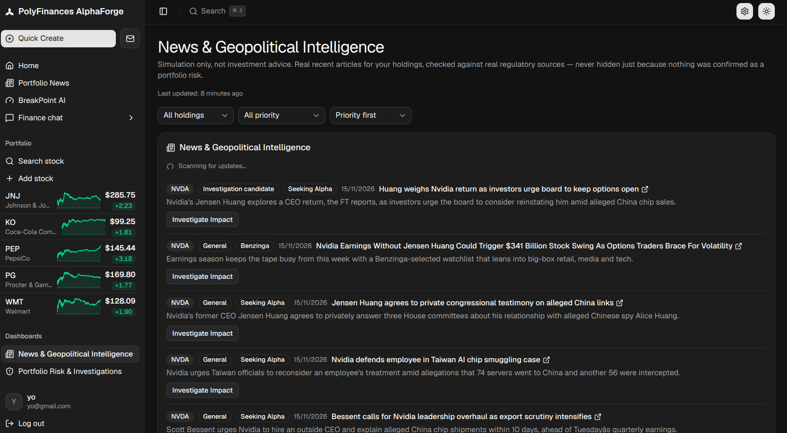

# Datathon PolyFinances 2026 : AlphaForge AI

Projet d'équipe pour le Datathon PolyFinances 2026, proposé avec la Banque Nationale et propulsé par AWS. Le défi AlphaForge AI demande de concevoir un outil qui utilise l'IA générative, les agents et des données financières publiques pour éclairer une décision d'investissement, selon trois personas fictifs : Prudent, Équilibré et Audacieux.

> Le tableau de bord Next.js et l’API FastAPI sont en place. Les fonctionnalités AlphaForge AI décrites dans l’approche prévue restent à développer.

## Contraintes du défi

- Simulation uniquement : aucune transaction réelle, et l'outil ne se présente pas comme un conseil financier personnalisé.
- Démarche avant performance : le jury valorise une démarche crédible et bien démontrée, pas le meilleur rendement passé.
- Traçabilité : chaque donnée cite sa source, sa date et sa devise, et on distingue faits, hypothèses et scénarios.

L'énoncé officiel fait foi et peut être précisé par les organisateurs sur place.

## Approche prévue

Le code calcule, le modèle explique. Rendements, volatilité et corrélations sont calculés avec pandas, puis un modèle de langage les met en contexte à partir de ces chiffres. On utilise les prix ajustés (`adj_close`) et on évite le biais d'anticipation (dates de publication plutôt que dates de fin de trimestre). La décision précise à éclairer et la comparaison de deux personas restent à définir.

## Pile technique envisagée

- Amazon Bedrock pour appeler les modèles (région de Montréal disponible)
- Strands Agents (Python) pour l'agent et ses outils de calcul
- Amazon SageMaker AI (JupyterLab) ou Kiro pour l'analyse
- pandas, NumPy, scikit-learn

Le compte AWS d'équipe est activé le 14 novembre 2026 et supprimé le 16 novembre en fin de journée. Le code doit être sur GitHub avant l'expiration.

## Démarrage

1. Démarrez le [serveur FastAPI](backend-server/README.md).
2. Dans un autre terminal, suivez le [guide du tableau de bord](frontend-dashboard/README.md), puis ouvrez [le tableau de bord local](http://localhost:3000) et créez un compte ou connectez-vous.

Le tableau de bord, basé sur [Studio Admin](https://github.com/arhamkhnz/next-shadcn-admin-dashboard), permet de suivre un portefeuille simulé, de consulter les cours et les actualités d’un titre et de repérer les actions du S&P 500 les plus citées dans les articles des dernières 24 heures. Les paramètres sont accessibles en cliquant sur votre nom dans la barre latérale.

L’API récupère les cours auprès de Yahoo Finance avec yfinance et les actualités auprès de [StocksFeed](https://stocksfeed.benollomo.com/). Amazon Aurora PostgreSQL conserve les comptes, les sessions et les positions du portefeuille. Consultez le [guide d’architecture](ARCHITECTURE.md) pour suivre les échanges entre les services.

Le [rapport du défi](DATATHON-CHALLENGE-REPORT.fr.md) et les [notes de l’atelier AWS](POLYFINANCES-WORKSHOP.md) documentent le contexte du projet.

## Équipe et licence

Membres de l'équipe :

- Sami Mostfa
- Pacifique Uwamukiza
- Benjamin Ollomo
- Mohamed Oubagha

