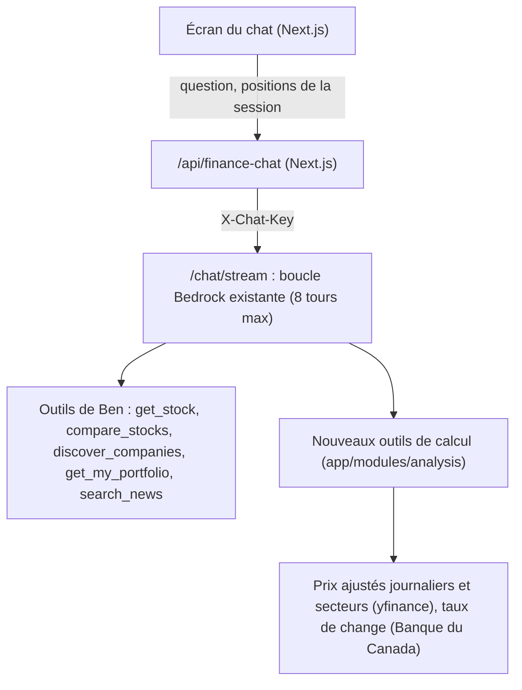

# Roadmap : agent de calcul AlphaForge AI

Rédigée le 14 novembre 2026, sur la branche `agent-calcul`. Révisée après la pull request #5 de Ben (chat en flux continu, portefeuille, déroulé des outils), puis recentrée sur les outils de calcul. Remise : dimanche 15 novembre à 23 h 59. Le déploiement et la configuration du chat en ligne sont décrits dans [ROADMAP-DEPLOIEMENT.md](ROADMAP-DEPLOIEMENT.md).

Légende : ✅ fait et vérifié · ⬜ à faire · ⚠️ à vérifier avant de s'y fier.

## 1. Objectif et portée

Répondre à une décision précise, avec des chiffres reproductibles :

> « Que change le transfert de X % de mon portefeuille vers le fonds Y ? »

C'est le scénario d'exemple des organisateurs (voir `context/defi-datathon.md`).

**Portée actuelle : les outils de calcul seulement.** On ajoute à l'agent de Ben des outils plus poussés que ceux qu'il a déjà. Les personas, le vérificateur des chiffres et l'affichage viendront ensuite (section 7).

| Critère du jury | Poids | Ce que les outils de calcul apportent |
|---|---:|---|
| Solution | 20 % | Le transfert est simulé et chiffré de bout en bout |
| Agentique | 20 % | Des outils avec un rôle chacun, et un contrôle des données imposé avant les comparaisons |
| Données | 20 % | Sources datées, calculs refaits par du code, cas de test chiffrés, détection d'une donnée manquante |
| AWS | 15 % | Amazon Bedrock choisit les outils et explique leurs résultats |

## 2. Ce que fait déjà l'agent de Ben

État de `main` au commit `42e47a9`. Code : `backend-server/app/modules/chat/` et `frontend-dashboard/src/app/(main)/dashboard/chat/`.

### Parcours d'une question
1. Dans le navigateur, l'utilisateur connecté pose sa question dans l'écran du chat.
2. Le serveur Next.js (`/api/finance-chat`) vérifie la session. Il relit en base les 10 derniers échanges, le dernier graphique, les dernières sources et le dernier cours consulté. Il ajoute les positions du portefeuille de l'utilisateur, lues dans Aurora, puis appelle le backend avec la clé `CHAT_API_KEY`.
3. Le backend (`/chat/stream`) appelle Claude Sonnet 4.6 sur Bedrock avec les outils. Le modèle choisit les outils, le code les exécute et renvoie les résultats. La boucle fait au plus 8 tours et s'arrête quand le modèle ne demande plus d'outil.
4. La réponse arrive en flux continu : d'abord le statut de chaque outil, puis le texte. Le code ajoute les sources (Yahoo Finance, StocksFeed) avec leur devise et leur date.
5. Le serveur Next.js enregistre la question, la réponse, les données et le déroulé des outils dans la table `chat_turns`.

### Les 5 outils

| Outil | Entrées | Ce qu'il renvoie |
|---|---|---|
| `get_stock` | Un symbole, une période (de `1d` à `5y`), un graphique ou non | Nom, place de cotation, devise, dernier cours et sa date, variation en valeur et en % sur la période, plus haut et plus bas avec leurs dates, intervalle des bougies, points du graphique si demandé |
| `compare_stocks` | Au moins 2 symboles, une période commune | Le résultat de `get_stock` pour chaque symbole, sur la même période |
| `discover_companies` | Secteur facultatif, fenêtre de 1 à 168 heures, nombre d'entreprises, période de comparaison facultative | Les entreprises du S&P 500 les plus citées par StocksFeed, et leurs cours si une période est demandée |
| `get_my_portfolio` | Une vue : `holdings`, `valuation` ou `news` | `holdings` : titres et quantités, positions séparées des titres suivis. `valuation` : cours, valeur, variation du jour et poids en % de chaque position, totaux **séparés par devise**. `news` : actualités des titres du portefeuille |
| `search_news` | Symboles ou sujet, fenêtre de 1 à 720 heures | Au plus 3 articles StocksFeed : titre, lien, éditeur, date, résumé |

### Les règles de sa consigne
- Éducation financière, réponse dans la langue de l'utilisateur, pas de conseil personnalisé.
- Un appel d'outil réel pour chaque chiffre. Ni appel simulé, ni donnée, prévision ou fondamental inventé.
- Le portefeuille vient seulement de `get_my_portfolio`, jamais du texte du chat.
- Variations présentées comme des variations de prix seulement, données manquantes signalées.
- Investissement hypothétique : capital × dernier cours ÷ cours de départ, sans dividendes, frais ni impôts.
- Sources numérotées, texte des articles traité comme non fiable.
- Format de réponse imposé : `FinanceAnswer(titre, explication, en-têtes, lignes)`, affiché comme un titre, un texte et un tableau.

### Ce qu'il ne fait pas, et l'outil qui le comblera

| Manque | Outil à ajouter |
|---|---|
| Aucune simulation de changement dans le portefeuille | `simulate_transfer`, qui part des positions et des poids de `get_my_portfolio` |
| Ni secteurs ni composition des fonds | `sector_exposure` |
| Seulement le poids de chaque ligne | `concentration` : indice de Herfindahl, poids des plus grandes lignes |
| Prix **non ajustés** (`auto_adjust=False`), souvent en bougies d'une heure | `risk_history`, avec une nouvelle fonction de prix journaliers ajustés. Ne pas modifier `fetch_history`, dont dépendent les graphiques et le chat. |
| Totaux séparés par devise, sans conversion | `convert_currency` |
| Période et devise vérifiées seulement par une consigne au modèle | `check_data`, vérifié dans le code |

⚠️ **Poids par devise.** `get_my_portfolio` calcule les poids séparément pour chaque devise. Un portefeuille qui mêle des titres en USD et en CAD n'a donc pas de poids global. Les outils de calcul doivent convertir les valeurs dans une même devise avant de calculer des poids.

## 3. Principe : le code calcule, le modèle explique

- Tous les chiffres viennent de fonctions Python déterministes. Le même calcul donne toujours le même résultat.
- Le modèle choisit les outils, puis explique leurs résultats. Il ne calcule rien.
- Chaque résultat porte sa valeur, son unité ou sa devise, sa période, sa source et sa date, et un statut (`ok`, `partial` ou `missing`).
- Simulation uniquement : aucune recommandation d'achat ou de vente.

## 4. Sources de données vérifiées

Testées le 14 novembre 2026 depuis l'environnement de travail.

| Besoin | Source | Résultat du test | Limites |
|---|---|---|---|
| Pondérations sectorielles d'un FNB | yfinance, `Ticker.funds_data.sector_weightings` | ✅ QQQ, XLK, XIU.TO et VFV.TO : 11 secteurs, somme de 100 % | Aucune date de composition fournie : dater avec la date de la requête et le signaler. Classification de Yahoo (`technology`, `consumer_cyclical`…), différente des noms GICS utilisés par StocksFeed (`Information Technology`). |
| Secteur d'une action | yfinance, `Ticker.info["sector"]` | ✅ AAPL et SHOP.TO : `Technology` | Même classification. Appel plus lent, à mettre en cache. |
| Principales lignes d'un FNB | yfinance, `funds_data.top_holdings` | ✅ 10 lignes pour QQQ, XLK et XIU.TO ; 1 seule pour VFV.TO (qui détient lui-même un fonds) | Liste incomplète : pas d'exposition par titre au-delà des 10 premières lignes |
| Prix journaliers ajustés | yfinance, `history(interval="1d", auto_adjust=True)` | ✅ QQQ sur 5 ans : 1 255 jours | Fuseau de la place de cotation, à aligner entre titres |
| Taux de change | API Valet de la Banque du Canada, `FXUSDCAD`, `FXEURCAD` | ✅ Taux du 13 novembre 2026 : 1,4257 CAD pour 1 USD | Un taux par jour ouvrable canadien, publié en fin de journée |

Les fichiers CSV de l'émetteur restent une solution de secours si yfinance ne renvoie rien pour un fonds.

## 5. Les outils de calcul

Nouveau module `backend-server/app/modules/analysis/`, séparé du chat. Fonctions de calcul pures (sans réseau) dans un fichier, accès aux données dans un autre, définitions des outils (`toolSpec`) au même format que ceux de Ben.

| Outil | Entrées | Calcul et sortie |
|---|---|---|
| `check_data` | Des symboles, une période | Pour chaque série : nombre de jours, première et dernière date, devise. Signale les périodes qui ne se recouvrent pas, les devises différentes et les données absentes. Ne comble aucun manque. |
| `convert_currency` | Des montants et leurs devises, une devise cible (CAD par défaut) | Montants convertis avec le taux de la Banque du Canada, et la date du taux utilisé |
| `simulate_transfer` | Le portefeuille (positions de la session), le symbole réduit, le symbole ajouté, le pourcentage | Valeurs converties dans une même devise, poids avant et après pour chaque ligne. Le montant transféré est le pourcentage de la valeur totale du portefeuille, retiré de la ligne réduite. |
| `sector_exposure` | Des poids par symbole (ceux d'avant et d'après, ou un portefeuille quelconque) | Poids de chaque secteur : somme des poids des lignes multipliés par la part du secteur dans chaque ligne. Indique la part du portefeuille dont le secteur est inconnu. |
| `concentration` | Des poids par symbole | Plus grande ligne, poids des 3 plus grandes lignes, indice de Herfindahl (somme des poids au carré) et nombre équivalent de lignes (1 ÷ Herfindahl) |
| `risk_history` | Des symboles et des poids, une période (1 à 10 ans) | Pour chaque symbole et pour le portefeuille pondéré : rendement total, rendement annualisé, volatilité annualisée (écart-type des rendements journaliers × √252), baisse maximale et ses dates, à partir des prix ajustés, sur les jours communs à tous les symboles |

Pour éviter d'épuiser les 8 tours de la boucle, `simulate_transfer` renvoie aussi l'exposition sectorielle et la concentration avant et après, en un seul appel. Les outils séparés restent utiles pour les questions sur le portefeuille actuel.

### Cas de test

| Cas | Résultat attendu |
|---|---|
| 20 % de technologie au départ, ligne réduite à 20 % de technologie, nouveau fonds à 80 %, transfert de 10 % | Exposition de **26 %** |
| Même cas, transfert de 5 % | **23 %** |
| Secteurs inconnus pour une ligne | Statut `partial`, part inconnue indiquée, aucune valeur inventée |
| Séries de périodes différentes | `check_data` signale l'écart |
| Pourcentage supérieur au poids de la ligne réduite | Erreur explicite, pas de poids négatif |

## 6. Phases

### Phase A : cadrage et coordination ⬜
- ⬜ **Coordination avec Ben** : les nouveaux outils s'enregistrent dans `routes.py`, son fichier. Garder le code de calcul dans `app/modules/analysis/` et limiter les changements de `routes.py` à quelques lignes.
- ⬜ Scénario de référence : symboles du fonds réduit et du fonds ajouté, pourcentage, période d'historique, devise (CAD). Les outils sont génériques et fonctionnent pour tout symbole.

### Phase B : données ⬜
- ⬜ Fonction de prix journaliers ajustés, à côté de `fetch_history` sans la modifier.
- ⬜ Lecture des pondérations sectorielles (FNB) et du secteur (actions), avec un cache en mémoire.
- ⬜ Lecture des taux de la Banque du Canada, avec un cache en mémoire.

### Phase C : calculs et tests ⬜
- ⬜ Les six outils de la section 5, en fonctions pures.
- ⬜ Les cas de test de la section 5.

**Critère de sortie :** les cas de test passent, en local.

### Phase D : intégration dans la boucle du chat ⬜
- ⬜ Enregistrer les outils dans la liste `available` de `reply_events` et leur exécution dans la boucle, avec les mêmes statuts (`completed`, `partial`, `failed`).
- ⬜ Exécuter `check_data` dans le code avant `risk_history`, sans attendre que le modèle le demande.
- ⬜ Ajouter quelques phrases courtes à la consigne système : quand utiliser les outils de calcul, chiffres seulement issus des outils, rappel de simulation. Vérifier que les questions habituelles du chat (cours, comparaison, actualités) répondent toujours bien.
- ⬜ Ajouter les entrées des nouveaux outils au filtre de `step["input"]`, pour qu'elles apparaissent dans le déroulé.
- ⬜ Libellés des nouveaux outils dans `activity-timeline.tsx`.

**Critère de sortie :** une question sur un transfert, posée dans le chat en local, déclenche les outils de calcul et renvoie une réponse qui cite leurs chiffres.

### Phase E : déploiement ⬜
- ⬜ Mettre à jour `ARCHITECTURE.md` et le README du backend (obligation de `AGENTS.md`).
- ⬜ Récupérer `main` avant la pull request (Ben y fusionne régulièrement).
- ⬜ Pull request de `agent-calcul` vers `main`. Le merge déclenche le déploiement automatique (10 à 15 minutes, canary).
- ⬜ Aucune nouvelle variable ni nouveau droit IAM : mêmes modèle et clé. Le backend doit pouvoir joindre `www.bankofcanada.ca` depuis ECS (sous-réseaux publics, comme pour Yahoo Finance).
- ⬜ Tester une question de transfert sur l'URL publique, après la fin du déploiement.

## 7. Étapes suivantes, hors de la portée actuelle

- **Personas** (Amira, Mateo, Robert) : un champ `persona` transmis au modèle, jamais aux outils.
- **Vérificateur des chiffres** : chaque nombre de la réponse doit venir d'un outil. Contrainte : la réponse est envoyée en flux continu, donc le résultat du contrôle s'afficherait sous la réponse.
- **Sorties des outils dans le déroulé**, qui n'affiche aujourd'hui que les entrées.
- **Affichage** : graphique avant et après, étiquettes fait, hypothèse ou scénario.
- **ESG** pour Mateo, et **Bedrock Guardrails** pour les affirmations qualitatives.

## 8. Risques

| Risque | Parade |
|---|---|
| Conflits avec le travail de Ben sur le chat | Code de calcul dans un module séparé, peu de lignes dans `routes.py`, récupération fréquente de `main` |
| Les ajouts à la consigne abîment les réponses actuelles du chat | Phrases courtes, tester les questions habituelles avant la pull request |
| Limite de 8 tours atteinte | `simulate_transfer` regroupe transfert, secteurs et concentration |
| Yahoo Finance limite les requêtes ou ne renvoie pas les secteurs d'un fonds | Cache en mémoire, statut `partial`, fichiers CSV de secours |
| Classification sectorielle de Yahoo différente de GICS | La nommer dans la sortie de l'outil |
| Composition des fonds non datée par yfinance | Dater avec la date de la requête et le signaler |
| Merge qui casse le site déployé | Tester en local avant la pull request, vérifier le site après la fin du déploiement canary |
