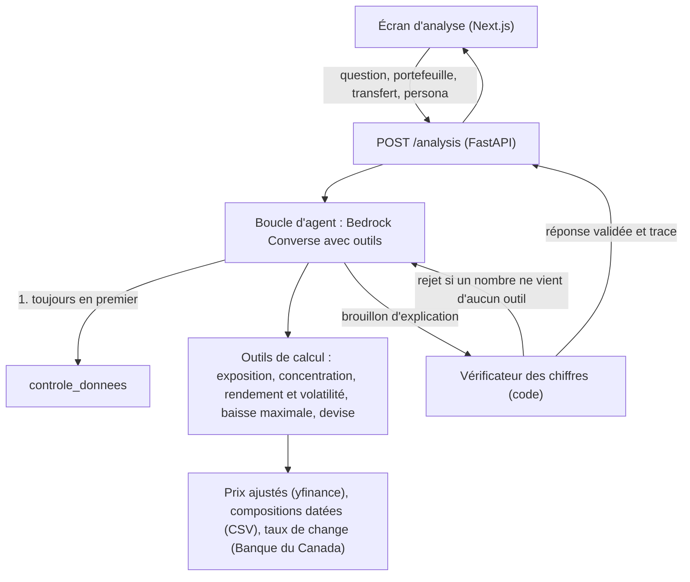

# Roadmap : agent de calcul AlphaForge AI

Rédigée le 14 novembre 2026 au soir, sur la branche `agent-calcul`. Remise : dimanche 15 novembre à 23 h 59. Le déploiement et le chat financier existants sont décrits dans [ROADMAP-DEPLOIEMENT.md](ROADMAP-DEPLOIEMENT.md).

Légende : ✅ fait et vérifié · ⬜ à faire · ⚠️ à vérifier avant de s'y fier.

## 1. Objectif

Répondre à une décision précise, avec des chiffres reproductibles et une explication adaptée au persona :

> « Que change le transfert de X % de mon portefeuille vers le fonds Y, selon que je suis Amira, Mateo ou Robert ? »

C'est le scénario d'exemple des organisateurs (voir `context/defi-datathon.md`). Le jury le reconnaîtra tout de suite.

| Critère du jury | Poids | Ce que l'agent de calcul apporte |
|---|---:|---|
| Solution | 20 % | Une décision formulée en une phrase, traitée de bout en bout |
| Agentique | 20 % | Des outils qui ont chacun un rôle, un contrôle avant comparaison, un vérificateur, une trace visible des appels réels |
| Données | 20 % | Sources datées, calculs refaits par du code, cas de test chiffrés, détection d'une donnée manquante |
| UX/UI | 10 % | Changer de persona et voir la contrainte qui change, sans explication orale |
| AWS | 15 % | Amazon Bedrock intervient dans le résultat affiché, avec ce qu'il reçoit et renvoie |

## 2. Principe : le code calcule, le modèle explique

- Tous les chiffres viennent de fonctions Python déterministes. Le même calcul donne toujours le même résultat.
- Le modèle (Claude Sonnet 4.6 sur Bedrock, déjà configuré pour le chat) choisit les outils, puis explique les résultats pour le persona. Il ne calcule rien.
- Chaque résultat d'outil porte sa valeur, son unité ou sa devise, sa période, sa source et sa date, et un statut (`ok` ou `donnée manquante`).
- Les calculs ne dépendent pas du persona. Seule l'interprétation change.
- Simulation uniquement : aucune recommandation d'achat ou de vente, ce qui relève du fait, de l'hypothèse et du scénario est étiqueté.

## 3. Phases

### Phase A : cadrage du scénario ⬜
Décisions d'équipe, à prendre avant d'écrire du code.
- ⬜ Portefeuille de référence : titres et poids (par exemple 3 à 5 FNB diversifiés).
- ⬜ Fonds réduit et fonds ajouté (le « fonds technologique médiatisé »), avec leurs émetteurs.
- ⬜ Pourcentage de transfert (10 %, puis 5 % pour l'essai de sensibilité).
- ⬜ Date d'observation, période d'historique (par exemple 5 ans) et devise de référence (CAD).
- ⬜ Seuils par persona, annoncés comme des choix de l'équipe. Exemple : une baisse maximale historique supérieure à 20 % est signalée pour un horizon de 3 à 5 ans (Robert).

**Critère de sortie :** le scénario (portefeuille, fonds, transfert, date, devise, seuils) est écrit et validé par l'équipe.

### Phase B : données ⬜
- ⬜ Prix journaliers **ajustés** : nouvelle fonction dans `backend-server/app/integrations/yahoo/service.py`. La fonction actuelle (`fetch_history`) sert les graphiques : elle utilise `auto_adjust=False` et des bougies d'une heure sur un an, ce qui ne convient pas au calcul de la volatilité.
- ⬜ Composition des fonds : fichiers CSV datés dans `backend-server/data/funds/`, pris sur le site de l'émetteur, avec l'URL et la date de la composition. ⚠️ yfinance ne fournit probablement pas la liste complète des avoirs d'un FNB (voir `context/VEILLE-TECHNOLOGIQUE.md`). Vérifier ce qu'il renvoie pour les fonds choisis avant de s'en passer.
- ⬜ Secteur de chaque titre : colonne du CSV de l'émetteur. La liste locale du S&P 500 (`frontend-dashboard/src/data/sp500.ts`) ne contient que les noms, sans secteur. StocksFeed classe les entreprises par secteur (`/stocks/most-mentioned`), ⚠️ à vérifier comme source.
- ⬜ Taux de change : API Valet de la Banque du Canada (série `FXUSDCAD`), gratuite et sans clé, avec la date de chaque observation.
- ⬜ ESG pour Mateo : la donnée publiée par l'émetteur, si elle existe. ⚠️ Probablement incomplète : prévoir de montrer ce manque comme une limite.
- ⬜ Vérifier les droits de redistribution avant de versionner les fichiers de composition dans le dépôt.

**Critère de sortie :** pour chaque donnée, la source, la date et la devise sont connues et notées.

### Phase C : outils de calcul et tests ⬜
Nouveau module `backend-server/app/modules/analysis/`, comme le demande `backend-server/AGENTS.md`. Fonctions pures, sans appel au modèle.

| Outil | Calcul |
|---|---|
| `controle_donnees` | Même période, même devise et même calendrier pour toutes les séries ; composition présente pour chaque fonds. Ne comble aucun manque. |
| `exposition_sectorielle` | Poids de chaque secteur avant et après : somme des poids des lignes multipliés par la part du secteur dans chaque ligne. |
| `concentration` | Poids des 10 plus grandes lignes et indice de Herfindahl (somme des poids au carré), avant et après. |
| `rendement_volatilite` | Rendement total et volatilité annualisée (écart-type des rendements journaliers × √252) sur la période fixée. |
| `baisse_maximale` | Plus forte baisse d'un sommet au creux suivant, avec ses dates. |
| `conversion_devise` | Conversion en CAD avec le taux de la date de chaque observation. |

Cas de test, fournis par les organisateurs :
- ⬜ 20 % de technologie au départ, fonds réduit à 20 %, nouveau fonds à 80 %, transfert de 10 % : exposition de **26 %**.
- ⬜ Même cas avec un transfert de 5 % : **23 %**.
- ⬜ Fichier de composition retiré : statut `donnée manquante`, aucune valeur inventée.
- ⬜ Changement de persona : résultats identiques.
- ⬜ Séries de périodes différentes : `controle_donnees` bloque la comparaison.

**Critère de sortie :** les cinq cas passent, en local.

### Phase D : orchestration par l'agent ⬜
- ⬜ Route `POST /analysis`, protégée par la même clé partagée que `POST /chat` (`CHAT_API_KEY`), car elle déclenche des appels Bedrock payants.
- ⬜ Boucle Bedrock `Converse` avec les outils de la phase C. Contrairement au chat actuel, qui fait un seul tour d'outils, l'analyse en demande plusieurs : limiter à 4 tours et arrêter quand le modèle ne demande plus d'outil.
- ⬜ `controle_donnees` est imposé en premier par le code, pas laissé au choix du modèle.
- ⬜ Trace : chaque appel réellement exécuté (nom, entrées, sorties, durée) est enregistré par le code et renvoyé avec la réponse. Le modèle ne la reconstitue pas.
- ⬜ Consigne système : éducation financière, pas de conseil personnalisé, chiffres seulement issus des outils, contenu des sources traité comme non fiable.
- ⬜ Décision à prendre : exposer aussi ces outils dans le chat existant, ou garder une route séparée. Je recommande la route séparée : elle ne touche pas au chat de Ben et isole la trace de l'analyse.

**Critère de sortie :** une requête du scénario renvoie une explication et une trace complète, en local.

### Phase E : vérificateur des chiffres ⬜
- ⬜ Extraire chaque nombre de l'explication et le chercher dans les sorties d'outils de la requête, avec une tolérance d'arrondi.
- ⬜ Si un nombre ne vient d'aucun outil : demander une seule réécriture au modèle, puis renvoyer une erreur explicite si elle échoue encore.
- ⬜ Afficher le résultat du contrôle dans la trace (« 7 chiffres vérifiés sur 7 »).
- ⬜ Optionnel : contrôle d'ancrage de Bedrock Guardrails (`ApplyGuardrail`) pour les affirmations qualitatives. ⚠️ À tester sur des réponses en français, demande un droit IAM de plus.

**Critère de sortie :** une réponse contenant un chiffre inventé est détectée et refusée lors d'un test volontaire.

### Phase F : personas ⬜
- ⬜ Définir les trois personas dans le code, à partir de `context/defi-datathon.md` : Amira (26 ans, risque élevé, 15 ans et plus), Mateo (41 ans, modéré, 8 à 12 ans, ESG), Robert (59 ans, faible à modéré, 3 à 5 ans).
- ⬜ Pour chaque persona : les chiffres mis en avant (concentration pour Amira, critère ESG pour Mateo, baisse maximale pour Robert) et les seuils de la phase A.
- ⬜ Une comparaison côte à côte de deux personas, avec la contrainte responsable de la différence.

**Critère de sortie :** le même scénario donne trois explications différentes à partir de chiffres identiques.

### Phase G : interface ⬜
Dans `frontend-dashboard/src/app/(main)/dashboard/`, en suivant `frontend-dashboard/AGENTS.md` (composants existants, aucune modification de `src/components/ui/`).
- ⬜ Écran d'analyse : choix du transfert, sélecteur de persona, bouton d'analyse.
- ⬜ Graphique avant et après, légendé, avec source et date.
- ⬜ Panneau de trace : outils appelés, entrées, sorties, résultat du vérificateur.
- ⬜ Étiquette fait, hypothèse ou scénario sur chaque chiffre.
- ⬜ Bandeau « ce qui a changé » entre deux personas.
- ⬜ États de chargement, d'erreur et de donnée manquante.
- ⬜ Appel serveur vers `POST /analysis` avec `BACKEND_API_URL` et la clé, comme le fait le chat.

**Critère de sortie :** une personne qui découvre l'écran change de persona et repère la contrainte qui change, sans explication orale.

### Phase H : intégration et déploiement ⬜
- ⬜ Mettre à jour `ARCHITECTURE.md`, les README et les `.env.example` concernés (obligation de `AGENTS.md`).
- ⬜ Pull request de `agent-calcul` vers `main`. Le merge déclenche le déploiement automatique (10 à 15 minutes, canary).
- ⬜ Aucune nouvelle variable ni nouveau droit IAM n'est prévu (même modèle, même clé). Si l'option Guardrails est retenue, ajouter `bedrock:ApplyGuardrail` au rôle de tâche du backend.
- ⬜ Si les fichiers de composition sont dans l'image, aucune configuration de plus. Sinon, prévoir leur emplacement (par exemple S3).
- ⬜ Tester le scénario complet sur l'URL publique, après la fin du déploiement.

**Critère de sortie :** le scénario fonctionne sur le site déployé, avec la trace et l'appel Bedrock visibles.

## 4. Ordre et temps estimé

| Ordre | Phase | Durée indicative | Dépend de |
|---|---|---|---|
| 1 | A : cadrage | 30 min | Rien |
| 2 | B : données | 1 h 30 | A |
| 3 | C : outils et tests | 2 h | B |
| 4 | D : orchestration | 1 h 30 | C |
| 5 | E : vérificateur | 1 h | D |
| 6 | F : personas | 1 h | D |
| 7 | G : interface | 2 à 3 h | D (E et F pour finir) |
| 8 | H : intégration | 1 h | Tout |

Total : environ 10 à 11 heures. Ce sont des estimations, pas des mesures. Les phases E, F et G peuvent avancer en parallèle si plusieurs coéquipiers travaillent.

**Coupe-feu.** Si dimanche à midi la phase D ne fonctionne pas, réduire la portée : une seule mesure (l'exposition sectorielle), deux personas, la trace sans le vérificateur. Un cas simple qui fonctionne de bout en bout vaut mieux qu'un cas riche inachevé.

## 5. Risques

| Risque | Parade |
|---|---|
| Composition des fonds introuvable ou non redistribuable | Fichiers CSV préparés à la main pour 2 ou 3 fonds, ou portefeuille fictif annoncé comme tel |
| Données ESG absentes | Montrer le manque comme une limite, ce que le jury valorise |
| Limitation des requêtes par Yahoo Finance | Mettre en cache les prix du scénario figé |
| Le modèle invente ou arrondit un chiffre | Vérificateur de la phase E |
| Latence de plusieurs appels Bedrock | Limite de 4 tours, indicateur de progression dans l'interface |
| Coût des appels Bedrock | Route protégée par la clé, une seule tâche par service |
| Merge qui casse le site déployé | Tester en local avant la pull request, vérifier le site après la fin du déploiement canary |
| Manque de temps | Coupe-feu de la section 4 |

## 6. Hors de portée

- Bedrock Guardrails pour les contrôles qualitatifs, sauf s'il reste du temps (option de la phase E).
- Nova Web Grounding et la recherche web : le chat utilise déjà StocksFeed pour l'actualité.
- Plusieurs agents qui débattent, ou un orchestrateur Swarm : la grille ne récompense pas le nombre d'agents.
- Strands Agents : la boucle `Converse` du chat suffit et ne demande aucune dépendance de plus. À reconsidérer seulement si l'orchestration devient complexe.
