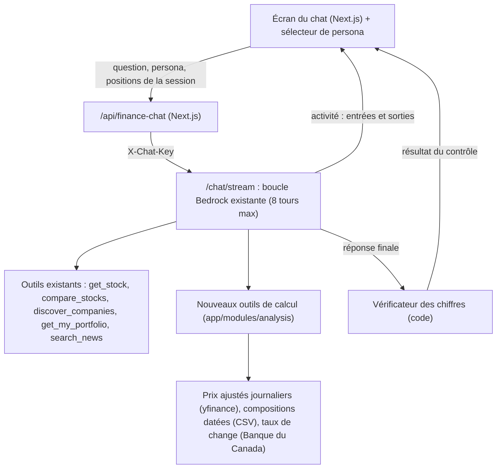

# Roadmap : agent de calcul AlphaForge AI

Rédigée le 14 novembre 2026, sur la branche `agent-calcul`, puis révisée après la pull request #5 de Ben (chat en flux continu, portefeuille, déroulé des outils). Remise : dimanche 15 novembre à 23 h 59. Le déploiement et la configuration du chat en ligne sont décrits dans [ROADMAP-DEPLOIEMENT.md](ROADMAP-DEPLOIEMENT.md).

Légende : ✅ fait et vérifié · ⬜ à faire · ⚠️ à vérifier avant de s'y fier.

## 1. Objectif

Répondre à une décision précise, avec des chiffres reproductibles et une explication adaptée au persona :

> « Que change le transfert de X % de mon portefeuille vers le fonds Y, selon que je suis Amira, Mateo ou Robert ? »

C'est le scénario d'exemple des organisateurs (voir `context/defi-datathon.md`).

| Critère du jury | Poids | Ce que l'agent de calcul apporte |
|---|---:|---|
| Solution | 20 % | Une décision formulée en une phrase, traitée de bout en bout |
| Agentique | 20 % | Des outils de calcul avec un rôle chacun, un contrôle avant comparaison, un vérificateur, une trace des appels réels avec leurs résultats |
| Données | 20 % | Sources datées, calculs refaits par du code, cas de test chiffrés, détection d'une donnée manquante |
| UX/UI | 10 % | Changer de persona et voir la contrainte qui change, sans explication orale |
| AWS | 15 % | Amazon Bedrock intervient dans le résultat affiché, avec ce qu'il reçoit et renvoie |

## 2. Ce qui existe déjà dans le chat de Ben

Le chat financier (`backend-server/app/modules/chat/`, `frontend-dashboard/src/app/(main)/dashboard/chat/`) fournit déjà une grande partie du socle. L'agent de calcul s'y ajoute au lieu de le refaire.

| Élément | Où | Ce qu'il fait | Ce qu'il ne fait pas |
|---|---|---|---|
| Boucle d'agent | `routes.py`, `reply_events` | Bedrock `Converse` (ou `ConverseStream`) avec outils, jusqu'à 8 tours, arrêt quand le modèle ne demande plus d'outil | Aucun outil n'est imposé en premier : le modèle choisit seul |
| Outils de données | `stock.py`, `discovery.py`, `news.py` | Cours et historique (`get_stock`), comparaison de titres sur une période (`compare_stocks`), entreprises les plus citées (`discover_companies`), actualités (`search_news`) | Pas de prix ajustés, pas de volatilité ni de baisse maximale, pas de secteurs ni de composition de fonds |
| Portefeuille | `portfolio.py`, outil `get_my_portfolio` | Lit les positions de l'utilisateur connecté (fournies par le serveur Next.js depuis Aurora, jamais par le texte du chat), valeur, variation du jour, poids de chaque ligne par devise | Pas de simulation de transfert, pas d'exposition sectorielle, pas d'indice de concentration |
| Trace | `activity` dans le flux, `activity-timeline.tsx`, colonne `tool_activity` | Affiche chaque outil appelé, son statut et ses entrées, et l'enregistre avec la réponse | N'affiche pas les **sorties** des outils |
| Rendu | OpenUI `FinanceAnswer(title, explanation, headers, rows)`, `portfolio-breakdown.tsx` | Réponse sous forme de titre, explication et tableau ; répartition vérifiée du portefeuille | Pas de graphique avant et après, pas d'étiquette fait, hypothèse ou scénario |
| Sécurité | `CHAT_API_KEY`, session Better Auth | Seul le serveur Next.js appelle le backend ; le portefeuille est celui de la session | Rien à ajouter |
| Personas | Aucun | | Le chat ne connaît pas Amira, Mateo ni Robert |

Conséquence : il n'y a **pas de nouvelle route** à créer. L'agent de calcul se compose de nouveaux outils dans un module séparé, enregistrés dans la boucle existante, d'un paramètre de persona, d'un vérificateur et de compléments d'affichage.

## 3. Principe : le code calcule, le modèle explique

- Tous les chiffres viennent de fonctions Python déterministes. Le même calcul donne toujours le même résultat.
- Le modèle (Claude Sonnet 4.6 sur Bedrock, déjà configuré) choisit les outils, puis explique les résultats pour le persona. Il ne calcule rien.
- Chaque résultat d'outil porte sa valeur, son unité ou sa devise, sa période, sa source et sa date, et un statut (`ok` ou `donnée manquante`).
- Les calculs ne dépendent pas du persona. Seule l'interprétation change.
- Simulation uniquement : aucune recommandation d'achat ou de vente ; ce qui relève du fait, de l'hypothèse et du scénario est étiqueté.

## 4. Phases

### Phase A : cadrage du scénario et coordination ⬜
Décisions d'équipe, à prendre avant d'écrire du code.
- ⬜ **Coordination avec Ben** : les nouveaux outils s'enregistrent dans `routes.py` et l'affichage touche ses composants. Convenir de qui modifie quoi, et garder les ajouts dans des fichiers séparés autant que possible pour limiter les conflits.
- ⬜ Portefeuille de référence : celui du compte connecté, ou un portefeuille d'exemple annoncé comme tel (par exemple 3 à 5 FNB diversifiés). Le chat lit déjà le portefeuille réel.
- ⬜ Fonds réduit et fonds ajouté (le « fonds technologique médiatisé »), avec leurs émetteurs.
- ⬜ Pourcentage de transfert (10 %, puis 5 % pour l'essai de sensibilité).
- ⬜ Période d'historique (par exemple 5 ans) et devise de référence (CAD).
- ⬜ Seuils par persona, annoncés comme des choix de l'équipe. Exemple : une baisse maximale historique supérieure à 20 % est signalée pour un horizon de 3 à 5 ans (Robert).

**Critère de sortie :** le scénario (portefeuille, fonds, transfert, période, devise, seuils) et le partage du travail avec Ben sont écrits et validés.

### Phase B : données ⬜
- ⬜ Prix journaliers **ajustés** : nouvelle fonction dans `backend-server/app/integrations/yahoo/service.py`. `fetch_history`, utilisée par les graphiques et par le chat, garde `auto_adjust=False` et des bougies d'une heure sur la plupart des périodes : elle ne convient pas au calcul de la volatilité, et il ne faut pas la modifier.
- ⬜ Composition des fonds : fichiers CSV datés dans `backend-server/data/funds/`, pris sur le site de l'émetteur, avec l'URL et la date de la composition. ⚠️ yfinance ne fournit probablement pas la liste complète des avoirs d'un FNB (voir `context/VEILLE-TECHNOLOGIQUE.md`). Vérifier ce qu'il renvoie pour les fonds choisis.
- ⬜ Secteur de chaque titre : colonne du CSV de l'émetteur. La liste locale du S&P 500 (`frontend-dashboard/src/data/sp500.ts`) ne contient que les noms. StocksFeed classe les entreprises par secteur, ⚠️ à vérifier comme source.
- ⬜ Taux de change : API Valet de la Banque du Canada (série `FXUSDCAD`), gratuite et sans clé, avec la date de chaque observation. Le chat sépare aujourd'hui les totaux par devise sans les convertir.
- ⬜ ESG pour Mateo : la donnée publiée par l'émetteur, si elle existe. ⚠️ Probablement incomplète : prévoir de présenter ce manque comme une limite.
- ⬜ Vérifier les droits de redistribution avant de versionner les fichiers de composition.

**Critère de sortie :** pour chaque donnée, la source, la date et la devise sont connues et notées.

### Phase C : outils de calcul et tests ⬜
Nouveau module `backend-server/app/modules/analysis/`, séparé du chat. Fonctions pures, sans appel au modèle. Chaque outil a sa définition (`toolSpec`) au même format que ceux du chat.

| Outil | Calcul |
|---|---|
| `check_data` | Même période, même devise et même calendrier pour les séries comparées ; composition présente pour chaque fonds. Ne comble aucun manque. |
| `simulate_transfer` | Nouvelles pondérations après le transfert de X % d'une ligne vers un fonds. Part des positions de `get_my_portfolio` ou du portefeuille d'exemple. |
| `sector_exposure` | Poids de chaque secteur avant et après : somme des poids des lignes multipliés par la part du secteur dans chaque ligne. |
| `concentration` | Poids des 10 plus grandes lignes et indice de Herfindahl (somme des poids au carré), avant et après. Complète le poids par ligne que `get_my_portfolio` donne déjà. |
| `risk_history` | Rendement total, volatilité annualisée (écart-type des rendements journaliers × √252) et baisse maximale avec ses dates, sur la période fixée, à partir des prix ajustés. |
| `convert_currency` | Conversion en CAD avec le taux de la date de chaque observation. |

Cas de test, fournis par les organisateurs :
- ⬜ 20 % de technologie au départ, fonds réduit à 20 %, nouveau fonds à 80 %, transfert de 10 % : exposition de **26 %**.
- ⬜ Même cas avec un transfert de 5 % : **23 %**.
- ⬜ Fichier de composition retiré : statut `donnée manquante`, aucune valeur inventée.
- ⬜ Changement de persona : résultats identiques.
- ⬜ Séries de périodes différentes : `check_data` bloque la comparaison.

**Critère de sortie :** les cinq cas passent, en local.

### Phase D : intégration dans la boucle du chat ⬜
- ⬜ Enregistrer les nouveaux outils dans la liste `available` de `reply_events` et leur exécution dans la boucle, avec le même traitement des statuts (`completed`, `partial`, `failed`).
- ⬜ Imposer `check_data` par le code avant `sector_exposure`, `concentration` et `risk_history` : si le modèle ne l'a pas appelé, le code l'exécute et joint son résultat. Aujourd'hui, le modèle choisit seul ses outils.
- ⬜ Compléter la consigne système : quand utiliser les outils de calcul, chiffres seulement issus des outils, rappel de simulation. La consigne est déjà longue : ajouter des phrases courtes et tester qu'elle n'abîme pas les réponses actuelles du chat.
- ⬜ Vérifier que 8 tours suffisent pour le scénario (portefeuille, contrôle, transfert, exposition, risque, devise). Sinon, regrouper des calculs dans un même outil plutôt qu'augmenter la limite.
- ⬜ Ajouter les entrées utiles des nouveaux outils à la liste filtrée de `step["input"]`, pour qu'elles apparaissent dans le déroulé.

**Critère de sortie :** une question du scénario, posée dans le chat en local, déclenche les outils de calcul et renvoie une réponse qui cite leurs chiffres.

### Phase E : trace complète et vérificateur ⬜
- ⬜ Trace : ajouter un **résumé des sorties** de chaque outil à l'événement `activity` (par exemple « technologie : 20 % → 26 % »), et l'afficher dans `activity-timeline.tsx`. Elle est déjà enregistrée dans `tool_activity` (JSONB), donc aucune migration n'est nécessaire.
- ⬜ Vérificateur : extraire chaque nombre de la réponse finale et le chercher dans les sorties des outils de la requête, avec une tolérance d'arrondi.
- ⬜ ⚠️ Contrainte du flux continu : la réponse est envoyée morceau par morceau **avant** d'être complète, donc elle ne peut pas être bloquée après coup. Deux options :
  1. Envoyer le résultat du contrôle comme dernier événement (« 7 chiffres vérifiés sur 7 », ou la liste des chiffres non trouvés) et l'afficher sous la réponse. Simple, mais un chiffre faux reste visible, signalé.
  2. Pour les questions qui utilisent les outils de calcul, retenir la réponse, la vérifier, puis l'envoyer ou demander une réécriture. Plus strict, mais l'utilisateur attend plus longtemps.
  Je recommande l'option 1, puis l'option 2 s'il reste du temps.
- ⬜ Optionnel : contrôle d'ancrage de Bedrock Guardrails (`ApplyGuardrail`) pour les affirmations qualitatives. ⚠️ À tester sur des réponses en français, demande un droit IAM de plus.

**Critère de sortie :** une réponse contenant un chiffre inventé est détectée et signalée lors d'un test volontaire.

### Phase F : personas ⬜
- ⬜ Définir les trois personas dans le code backend, à partir de `context/defi-datathon.md` : Amira (26 ans, risque élevé, 15 ans et plus), Mateo (41 ans, modéré, 8 à 12 ans, ESG), Robert (59 ans, faible à modéré, 3 à 5 ans).
- ⬜ Ajouter un champ `persona` à `ChatRequest` (backend) et à la requête de `/api/finance-chat` (frontend). La consigne système reçoit le profil choisi : chiffres mis en avant et seuils de la phase A.
- ⬜ Garder les mêmes chiffres quel que soit le persona : le persona n'est transmis qu'au modèle, jamais aux outils de calcul.
- ⬜ Comparaison de deux personas : poser la même question avec un autre persona, et afficher la contrainte responsable de la différence.

**Critère de sortie :** le même scénario donne trois explications différentes à partir de chiffres identiques.

### Phase G : interface ⬜
Dans `frontend-dashboard/src/app/(main)/dashboard/chat/`, en suivant `frontend-dashboard/AGENTS.md` (composants existants, aucune modification de `src/components/ui/`).
- ⬜ Sélecteur de persona dans l'écran du chat, transmis avec chaque question.
- ⬜ Rendu des résultats de calcul : le format `FinanceAnswer` (titre, explication, tableau) suffit pour l'exposition avant et après. Ajouter un graphique avant et après légendé, avec source et date, dans un composant séparé, sur le modèle de `portfolio-breakdown.tsx`.
- ⬜ Étiquette fait, hypothèse ou scénario sur les chiffres de l'analyse.
- ⬜ Libellés français ou anglais des nouveaux outils dans `activity-timeline.tsx` (tableau `labels`).
- ⬜ Affichage du résultat du vérificateur sous la réponse.
- ⬜ Bandeau « ce qui a changé » quand on repose la question avec un autre persona.

**Critère de sortie :** une personne qui découvre l'écran change de persona et repère la contrainte qui change, sans explication orale.

### Phase H : intégration et déploiement ⬜
- ⬜ Mettre à jour `ARCHITECTURE.md`, les README et les `.env.example` concernés (obligation de `AGENTS.md`).
- ⬜ Récupérer `main` avant la pull request (Ben y fusionne régulièrement), résoudre les conflits dans `routes.py` et les composants du chat.
- ⬜ Pull request de `agent-calcul` vers `main`. Le merge déclenche le déploiement automatique (10 à 15 minutes, canary).
- ⬜ Aucune nouvelle variable ni nouveau droit IAM n'est prévu (même modèle, même clé). Si l'option Guardrails est retenue, ajouter `bedrock:ApplyGuardrail` au rôle de tâche du backend.
- ⬜ Les fichiers de composition dans `backend-server/data/` sont inclus dans l'image si le `Dockerfile` les copie. ⚠️ Le `Dockerfile` actuel ne copie que `app/` : l'ajuster, ou placer les fichiers sous `app/`.
- ⬜ Tester le scénario complet sur l'URL publique, après la fin du déploiement.

**Critère de sortie :** le scénario fonctionne sur le site déployé, avec la trace et l'appel Bedrock visibles.

## 5. Ordre et temps estimé

| Ordre | Phase | Durée indicative | Dépend de |
|---|---|---|---|
| 1 | A : cadrage et coordination | 30 min | Rien |
| 2 | B : données | 1 h 30 | A |
| 3 | C : outils et tests | 2 h | B |
| 4 | D : intégration dans la boucle | 1 h | C |
| 5 | E : trace et vérificateur | 1 h | D |
| 6 | F : personas | 1 h | D |
| 7 | G : interface | 1 h 30 à 2 h | D (E et F pour finir) |
| 8 | H : intégration et déploiement | 1 h | Tout |

Total : environ 9 à 10 heures, contre 10 à 11 heures avant la révision, grâce à la boucle, à la trace et au rendu déjà présents dans le chat. Ce sont des estimations, pas des mesures. Les phases E, F et G peuvent avancer en parallèle si plusieurs coéquipiers travaillent.

**Coupe-feu.** Si dimanche à midi la phase D ne fonctionne pas, réduire la portée : un seul outil (`simulate_transfer` avec l'exposition sectorielle), deux personas, la trace sans le vérificateur. Un cas simple qui fonctionne de bout en bout vaut mieux qu'un cas riche inachevé.

## 6. Risques

| Risque | Parade |
|---|---|
| Conflits avec le travail de Ben sur le chat | Coordination en phase A, code de calcul dans un module séparé, récupération fréquente de `main` |
| Les ajouts à la consigne système abîment les réponses actuelles du chat | Phrases courtes, tester des questions existantes (cours, comparaison, actualités) avant la pull request |
| Limite de 8 tours atteinte | Regrouper les calculs dans un même outil |
| Chiffre faux déjà affiché à cause du flux continu | Résultat du vérificateur affiché sous la réponse (phase E) |
| Composition des fonds introuvable ou non redistribuable | Fichiers CSV préparés à la main pour 2 ou 3 fonds, ou portefeuille fictif annoncé comme tel |
| Données ESG absentes | Présenter le manque comme une limite, ce que le jury valorise |
| Limitation des requêtes par Yahoo Finance | Mettre en cache les prix du scénario |
| Coût des appels Bedrock | Chat réservé aux utilisateurs connectés et protégé par la clé partagée, une seule tâche par service |
| Merge qui casse le site déployé | Tester en local avant la pull request, vérifier le site après la fin du déploiement canary |
| Manque de temps | Coupe-feu de la section 5 |

## 7. Hors de portée

- Une route d'analyse séparée du chat : la boucle existante suffit.
- Bedrock Guardrails pour les contrôles qualitatifs, sauf s'il reste du temps (option de la phase E).
- Nova Web Grounding et la recherche web : le chat utilise déjà StocksFeed pour l'actualité.
- Plusieurs agents qui débattent, ou un orchestrateur Swarm : la grille ne récompense pas le nombre d'agents.
- Strands Agents : la boucle `Converse` du chat suffit et ne demande aucune dépendance de plus.
