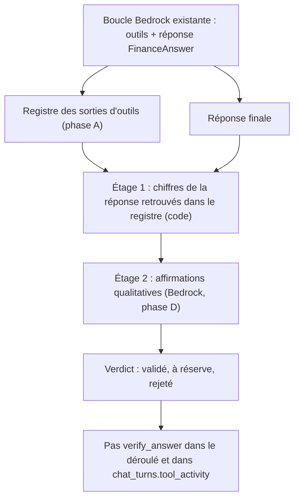

# Roadmap : agent vérificateur AlphaForge AI

Rédigée le 14 novembre 2026, sur la branche `agent-verificateur` (créée depuis `main` au commit `0dc7e38`, après la fusion de `agent-calcul`). Remise : dimanche 15 novembre à 23 h 59. Le déploiement est décrit dans [ROADMAP-DEPLOIEMENT.md](ROADMAP-DEPLOIEMENT.md). L'agent de calcul est décrit dans [ROADMAP-AGENT-CALCUL.md](ROADMAP-AGENT-CALCUL.md).

Légende : ✅ fait et vérifié · ⬜ à faire · ⚠️ à vérifier avant de s'y fier.

## 1. Objectif et portée

Après chaque réponse du chat, un second agent relit la réponse et contrôle que chaque chiffre vient d'un outil appelé pendant la même question. Il signale ce qui ne passe pas, et l'interface l'affiche.

> « Cette réponse contient-elle un chiffre que personne n'a calculé ni lu dans une source ? »

Le défi demande qu'un agent ait une raison d'exister et que l'on voie quelle vérification a influencé la réponse (`context/idees-datathon.md`). Le générateur de réponses n'a aujourd'hui qu'une consigne qui lui interdit d'inventer. Rien dans le code ne le contrôle.

| Critère du jury | Poids | Ce que le vérificateur apporte |
|---|---:|---|
| Agentique | 20 % | Un second agent avec un objectif distinct, dont le verdict est visible dans le déroulé |
| Données | 20 % | Une vérification capable de détecter une erreur, montrée en direct, et des cas de test chiffrés |
| Solution | 20 % | Une réponse dont on peut dire quels chiffres ont été contrôlés |
| AWS | 15 % | Amazon Bedrock sert aussi au contrôle des affirmations qualitatives (phase D) |

**Hors de la portée :** personas, ESG, Guardrails, agent de débat, graphique avant et après. Ils sont listés en section 8.

## 2. Ce qui existe et ce qu'il impose

Code : `backend-server/app/modules/chat/routes.py` (fonction `reply_events`), `backend-server/app/modules/analysis/tools.py`, `frontend-dashboard/src/app/api/finance-chat/route.ts`.

| Constat dans le code | Conséquence pour le vérificateur |
|---|---|
| Chaque appel d'outil produit une liste `evidence`, envoyée au modèle puis oubliée. Seuls `news`, `stock` et `portfolio` survivent jusqu'à l'événement `done`. | Il faut garder un registre de toutes les sorties d'outils de la question (phase A). |
| Les calculs ont un statut (`completed`, `partial`, `failed`) renvoyé avec chaque outil. | Le vérificateur peut exiger qu'un statut `partial` ou `failed` soit mentionné dans la réponse. |
| La réponse finale est une expression OpenUI `FinanceAnswer(title, explanation, headers, rows)`. | Les chiffres se trouvent dans `title`, `explanation` et `rows`. Il faut analyser cette expression, pas du texte libre. |
| `model_events` publie la réponse au fil de l'eau, dès que `root = FinanceAnswer(` apparaît. | Le contrôle ne peut pas précéder l'affichage sans changer le flux. Voir la décision D1. |
| Le serveur Next.js enregistre le déroulé des outils (`tool_activity`) avec la question et la réponse. | Un pas `verify_answer` dans le déroulé est enregistré sans migration de base de données. |
| Le déroulé n'affiche que les entrées des outils : `step["input"]` est filtré par une liste de clés. | Il faut ajouter un champ de sortie au pas d'activité pour afficher le verdict (phase C). |
| La question reçoit aussi des données de référence : `chart`, `previous_stock`, `previous_news`, les 10 échanges précédents. | Ces sources sont légitimes. Un chiffre qui vient d'elles ne doit pas être rejeté. |
| La boucle d'outils est limitée à 8 tours. | Le vérificateur s'exécute après la boucle, il ne consomme aucun tour. |

### 2.1 Formes des sorties d'outils (relevé de la phase A)

Chaque entrée du registre contient `evidence`, une liste de dictionnaires à une seule clé. La clé indique l'origine.

| Clé dans `evidence` | Outil | Contenu utile au contrôle | Unités et pièges |
|---|---|---|---|
| `Yahoo Finance` | `get_stock`, `compare_stocks`, `discover_companies` (avec période) | `price`, `previousClose`, `baseline`, `priceChange`, `percentChange`, `history.{firstClose, lastClose, high, low}`, `currency`, `asOf` | `percentChange` est déjà en pourcentage (3,2 veut dire 3,2 %). Les `points` du graphique sont retirés avant l'enregistrement. Les dates sont des chaînes ISO. |
| `StocksFeed coverage ranking` | `discover_companies` | `sector`, `hours`, `asOf`, liste `stocks` avec le nombre d'articles | Les nombres d'articles sont des entiers. |
| `signed-in portfolio` | `get_my_portfolio` | `positions` (quantité, cours, `value`, `dailyChange`, `weightPercent`), `totals` par devise avec `value`, `dailyChange`, `dailyPercent` | Totaux séparés par devise, jamais additionnés entre devises. `weightPercent` et `dailyPercent` en pourcentage. |
| `StocksFeed sources in citation order` | `search_news`, `get_my_portfolio` (vue news) | `stories` : titre, éditeur, date, résumé de 1 800 caractères au plus | Les nombres des résumés sont du texte. Un chiffre cité d'un article se trouve dans une chaîne, pas dans un champ numérique. |
| `AlphaForge calculation` | les six outils de calcul | Voir `analysis/tools.py` : `weightsPercent`, `sectorExposure.*.sectorsPercent`, `changeBySector.changePoints`, `concentration` (`herfindahl`, `effectiveLines`), `bySymbol.*` et `portfolio` de `risk_history` (`totalReturnPercent`, `annualizedVolatilityPercent`, `maxDrawdown.percent`), `portfolioValue.totalCAD`, `conversions` | Les champs en `...Percent` sont en pourcentage, `herfindahl` est un ratio entre 0 et 1, `changePoints` est en points de pourcentage. Les valeurs sont arrondies par l'outil (2 à 4 décimales). |
| `lookup unavailable`, `stock lookup unavailable`, `news lookup unavailable`, `portfolio news`, `unavailable` | tous | Entrée qui n'a pas abouti, avec les arguments | Pas de chiffre à retrouver. Le statut de l'enregistrement vaut `failed` ou `partial`. |

Conséquences pour la phase B :
- L'extraction des nombres doit parcourir une structure JSON quelconque, sans lire des champs choisis un par un. Elle garde le chemin de chaque nombre (par exemple `AlphaForge calculation → sectorExposure.after.sectorsPercent.technology`) pour nommer la source dans le verdict.
- Il faut aussi lire les nombres écrits dans les chaînes (résumés d'articles), mais les marquer comme source de type texte, moins fiable.
- Les nombres sont dans des unités variées (pourcentage, ratio, points, montant avec devise). Le verdict doit tenir compte de l'unité de la source.

## 3. Principe : un contrôle en deux étages

1. **Étage déterministe (code Python).** Extrait les nombres de la réponse et cherche chacun dans le registre des sorties d'outils. Gratuit, reproductible, ne se trompe pas d'un cas à l'autre.
2. **Étage Bedrock (second appel de modèle).** Lit la réponse et les sorties d'outils, puis juge ce que le code ne peut pas juger : causalité tirée d'un titre de presse, conseil déguisé, donnée manquante non signalée.

Le premier étage fait l'essentiel du travail et se démontre sans modèle. Le second est ce qui en fait un agent. On ne le présentera comme tel que s'il est réellement branché (phase D).

## 4. Décisions à prendre

| Décision | Options | Recommandation |
|---|---|---|
| **D1. Moment du contrôle** | (a) Après l'affichage : la réponse apparaît, puis le verdict s'ajoute. (b) Avant l'affichage : on retient la réponse finale, on la contrôle, puis on l'envoie. | Commencer par (a), qui ne change pas le flux continu. Passer à (b) seulement si la phase E (correction) est faite. Avec (b), la réponse arrive d'un bloc après le contrôle. |
| **D2. Que faire d'un chiffre rejeté** | (a) Seulement l'afficher. (b) Redemander une réponse au modèle avec la liste des chiffres rejetés, une seule fois. | (a) d'abord. (b) en phase E, avec une seule reprise pour borner le coût et la durée. |
| **D3. Modèle de l'étage 2** | Le même modèle que le chat (`BEDROCK_MODEL_ID`), ou un modèle plus petit configuré à part. | Le même modèle au début : aucune variable ni droit IAM nouveau. Un modèle séparé seulement si la durée devient gênante. |
| **D4. Où s'affiche le verdict** | Dans le déroulé existant, ou un badge sous la réponse. | Le déroulé d'abord (aucune migration). Le badge en phase C si le temps le permet. |

## 5. Les règles de contrôle

### Étage 1 : chiffres

| Règle | Détail |
|---|---|
| Nombres analysés | Pourcentages, points, montants avec devise, ratios, cours, dans `title`, `explanation`, `headers` et `rows`. |
| Nombres ignorés | Références de sources (`[1]`), dates et heures, années, numéros de liste, noms d'indices (`S&P 500`), durées de période (« 5 ans », « 30 jours », `1mo`), et le texte d'illustration qui suit « par exemple », « for example » ou « e.g. » jusqu'à la fin de la phrase. |
| Correspondance | Un nombre de la réponse correspond à un nombre de la source si leurs valeurs coïncident à la précision affichée : `26,3 %` correspond à `26.32`, `26,4 %` non, `26 %` oui. Les formats français et anglais sont lus (`1 255`, `1,255`, `1.255`, `1 255,5`, `1,255.5`). Un format ambigu comme `1,255` est lu des deux façons. |
| Signe | Un nombre écrit avec `+` ou `-` doit avoir le signe de la source. Sans signe, « baisse de 35,12 % » correspond à `-35.12`. |
| Unités et devises | Un pourcentage ne s'apparie pas avec un montant. Un montant en `USD` ne s'apparie pas avec une valeur en `CAD`. Un taux de change n'est pas un montant. Un ratio (indice de Herfindahl) écrit en pourcentage est retrouvé (`0,42` devient `42 %`) et signalé `scaled`. Les multiplicateurs `million`, `milliard`, et `k` ou `M` collés à une devise sont lus. |
| Sources acceptées | Sorties des outils de la question dont le statut n'est pas `failed`, la question de l'utilisateur, puis les données de référence transmises (`chart`, `previous_stock`, `previous_news`, échanges précédents). Le verdict nomme la source et le chemin de chaque nombre retrouvé. |
| Valeurs dérivées | Trois cas seulement, tous signalés `à réserve` avec leurs opérandes : (1) un écart écrit **en points** entre deux pourcentages du même appel d'outil ; (2) la variation entre les valeurs `before` et `after` d'un même outil, si le nombre a au moins une décimale ; (3) un calcul simple sur les nombres de la question (somme, différence, produit, quotient, « x % de y »). Une différence entre deux pourcentages écrite sans décimale n'est pas acceptée : avec ~30 valeurs, elle tomberait sur un écart au hasard. |
| Nombres faibles | Un entier sans unité ni séparateur (« 3 lignes ») et les valeurs structurelles (`0`, `100 %`, `1,00` comme maximum) donnent `à réserve` s'ils n'ont pas de source, jamais `rejeté`. |
| Verdict | `validé` : tous les nombres retrouvés. `à réserve` : au moins une valeur dérivée ou un nombre faible sans source. `rejeté` : au moins un nombre fort sans source. `non évalué` : la réponse n'est pas une expression `FinanceAnswer` lisible. |

### Étage 2 : affirmations (phase D)

- Cause attribuée à un titre de presse ou à un mouvement de prix, alors que la consigne l'interdit.
- Formulation qui ressemble à un conseil d'achat ou de vente.
- Statut `partial` ou `failed` d'un outil non mentionné dans la réponse.
- Comparaison de séries de périodes ou de devises différentes sans l'avoir dit.

Le modèle renvoie un objet structuré (affirmation, règle enfreinte, citation de la réponse), pas un texte libre.

## 6. Phases

### Phase A : registre des preuves ✅
Réalisée le 14 novembre 2026.
- ✅ `backend-server/app/modules/verification/ledger.py` : `EvidenceLedger` et `ToolRecord` (identifiant d'appel, outil, statut, arguments, sorties). Chaque sortie est copiée par un aller-retour JSON : le registre garde ce que le modèle a reçu, même si l'objet d'origine change ensuite.
- ✅ `routes.py` : 3 lignes ajoutées dans `reply_events` (import, création du registre, `ledger.record(...)` juste avant l'envoi du statut final de l'outil). Ce que reçoit le modèle et les événements envoyés au navigateur ne changent pas.
- ✅ Formes des sorties relevées (section 2.1).
- ✅ Vérifié avec un faux client Bedrock : une question qui déclenche trois appels (un `get_stock` réussi, un `get_stock` au symbole invalide, un outil inconnu) laisse trois entrées dans le registre, avec les statuts `completed`, `failed` et `failed`. Les 13 tests existants passent.
- ⚠️ Non vérifié : un appel réel à Bedrock en mode flux continu. Le code ajouté est le même dans les deux modes, car il se trouve avant l'envoi du statut.
- ⚠️ Le registre n'est pas encore lu par personne. Il le sera en phase B.

**Critère de sortie :** atteint. Une entrée par appel d'outil, y compris pour les outils en échec.

### Phase B : étage déterministe ✅
Réalisée le 14 novembre 2026.
- ✅ `verification/numbers.py` : lecture de l'expression `FinanceAnswer` (arguments JSON positionnels, guillemets et parenthèses dans les chaînes), extraction des nombres avec unité, signe, devise et tolérance, et parcours d'un JSON quelconque en gardant le chemin de chaque nombre.
- ✅ `verification/checks.py` : `verify_answer(texte, enregistrements, question=..., references=...)` renvoie un `Report` (verdict et résultat par nombre, avec la source ou les opérandes). `Report.to_dict()` donne la forme JSON pour la phase C. Fonctions pures, sans réseau.
- ✅ `backend-server/tests/test_verification.py` : 31 tests, qui couvrent les cas de la section 7. Les 44 tests du projet (13 de calcul, 31 de vérification) passent.
- ✅ Essai sur des réponses réelles : les réponses du modèle Bedrock enregistrées par `backend-server/evals/eval_calc_agent.py` (18 questions, 3 passages chacun, soit 54 réponses, fichier `evals/last-run.json`, non suivi par git et écrit par un autre membre de l'équipe) ont été rejouées dans le vérificateur. Le fichier ne garde que les entrées des outils : j'ai relancé les mêmes outils sur les mêmes données synthétiques pour reconstituer leurs sorties.
  - Les 54 réponses sont lisibles : aucune n'est `non évalué`.
  - Conversion de devises, risque historique, transfert trop grand, poids non normalisés : `validé`, avec 5 à 24 nombres contrôlés. Transfert avec portefeuille enregistré : `validé` (1 passage) ou `à réserve` (2 passages, variations calculées par le modèle), avec 29 à 40 nombres contrôlés.
  - Transferts : `à réserve`, à cause des variations calculées par le modèle (`−0,18` sur l'indice de Herfindahl, `−5 pts`).
  - Détections réelles : dans `mine-concentration`, le modèle écrit des valeurs de marché de 1 000 USD qui ne figurent dans aucune sortie d'outil. Dans `concentration-3`, il cite des indices d'exemple (0,25, 0,33). Les deux sont `rejeté`.
  - Trois faux rejets trouvés par cet essai et corrigés : taux de change lu comme un montant en devise, `1,00` comme maximum de l'indice, texte d'exemple (« par exemple : 40 % en AAPL »).
- ⚠️ Limites connues de l'étage 1 :
  - Un nombre inventé qui coïncide avec un nombre de la source est accepté (le contrôle vérifie la présence, pas le sens). L'unité, la devise et le signe réduisent ce risque.
  - `$` seul n'indique pas la devise, donc aucun contrôle de devise pour lui.
  - Les nombres cités depuis un article sont comparés à des chaînes de texte, sans garantie de sens.
  - La mention « par exemple » masque le nombre qui suit : un modèle pourrait y cacher un chiffre. L'étage 2 relit ces phrases.
  - Les rejeux ont été faits sur des données synthétiques, pas sur des cours réels.
  - Aucun appel réel de Bedrock n'a été fait pour cette phase, et le vérificateur n'est pas encore branché au chat.

**Critère de sortie :** atteint. Les tests passent, et la fonction donne un verdict stable sur des réponses réelles de transfert (verdict `à réserve` à cause des variations calculées par le modèle). Elle est pure : mêmes entrées, même verdict.

### Phase C : intégration et affichage ✅ (backend), ⚠️ (frontend non vérifié)
Réalisée le 14 novembre 2026.
- ✅ `verification/step.py` : `verification_activity(...)` construit le pas `verify_answer` (statut `completed` pour `validé`, `partial` pour `à réserve` et `non évalué`, `failed` pour `rejeté`) avec le rapport dans `output`. Une exception dans le contrôle est journalisée et donne `non évalué` : la réponse part quand même.
- ✅ `routes.py` : 4 lignes dans `reply_events`, après la boucle d'outils et avant les sources. Le contrôle ne s'exécute qu'en flux continu (`/chat/stream`). `POST /chat` ne change pas. Il ne consomme aucun tour de la boucle.
- ✅ `Report.to_dict()` ajoute un code neutre (`verified`, `review`, `rejected`, `unverified`) pour le dashboard, qui n'est pas en français.
- ✅ Aucune migration : le serveur Next.js enregistre déjà tous les pas d'activité dans `chat_turns.tool_activity`. `route.ts` n'a pas changé.
- ✅ Frontend : type `FigureCheck` et champ `output` dans `chat-stream.ts`. `activity-timeline.tsx` affiche le verdict dans le résumé et dans le pas « Check figures », avec les chiffres sans source et les chiffres calculés (opérandes raccourcis). Les appels d'outils sont comptés sans le pas de contrôle. Une réponse enregistrée avant cette phase n'a pas ce pas et s'affiche comme avant (lu dans le code, non essayé).
- ✅ `ARCHITECTURE.md` (paragraphe et flèche du diagramme) et README du backend (section « Figure check »).
- ✅ Vérifié en local avec le vrai modèle Bedrock (données de marché synthétiques de `evals/`) :
  - Question de transfert de 10 % : outils `simulate_transfer` et `sector_exposure`, puis `verify_answer` en statut `partial`, verdict `à réserve`, **38 chiffres contrôlés**, aucun sans source. Les 3 chiffres signalés sont des variations que le modèle a calculées lui-même (`−10,0 pts`, `−0,18` sur l'indice de Herfindahl, `+0,22` sur le nombre effectif de lignes). Le verdict n'est donc pas `validé`, contrairement à ce que prévoyait le critère de sortie.
  - Question sans outil (« Combien font 15 % de 2 000 $ ? ») : réponse correcte, verdict `à réserve` (calcul sur les chiffres de la question).
  - Faux Bedrock : un chiffre inventé (`+7,9 %`) donne `rejeté` avec `failed` et le chiffre nommé. Une panne simulée du contrôle donne `non évalué` et la réponse arrive.
- ⚠️ Non vérifié : l'affichage dans le navigateur, `npm run check` et le typage du frontend (la consigne du dashboard demande de ne les lancer que sur demande), et la relecture d'un fil enregistré.
- ⚠️ Constaté pendant l'essai : une variation écrite par le modèle peut correspondre à plusieurs paires d'opérandes. Le contrôle nomme d'abord la plus précise (variation entre `before` et `after`), puis les autres.

**Critère de sortie :** atteint pour le backend : le pas `verify_answer` apparaît dans le déroulé d'une vraie question de transfert avec son verdict et le nombre de chiffres contrôlés, et une question simple répond toujours. L'affichage reste à vérifier dans le navigateur.

### Phase D : étage Bedrock ✅
Réalisée le 14 novembre 2026.
- ✅ `verification/judge.py` : un appel `converse` avec la réponse, la question et les sorties d'outils (6 000 caractères par outil, 24 000 au total), `toolChoice` forcé sur `report_findings`, `temperature` 0. La sortie est validée par Pydantic (règle parmi quatre, citation, raison ; les textes trop longs sont coupés à 300 caractères, 8 constats au plus). Le texte des articles est présenté comme donnée, jamais comme consigne.
- ✅ Quatre règles : `causal_claim`, `advice`, `unreported_gap`, `mismatched_series`. Le juge ne juge jamais un chiffre.
- ✅ Garde-fous en code, après la réponse du modèle. Un constat est écarté si (1) sa citation n'est pas dans la réponse (comparaison insensible à la casse et aux espaces), (2) pour `unreported_gap` et `mismatched_series`, aucun outil n'a un statut `partial` ou `failed`, (3) pour `causal_claim`, la citation ne contient aucun mot de causalité (« à cause de », « because », « driven by »…).
- ✅ Intégration : `step.py` envoie d'abord `verify_answer` en `running`, puis le résultat. Le juge peut faire passer `validé` à `à réserve`, jamais rejeter. Une panne (modèle, réseau, sortie invalide) donne `judge: unavailable` et le verdict de l'étage 1 reste. Délai de lecture de 30 s, une seule tentative.
- ✅ Décision D3 : le même modèle (`BEDROCK_MODEL_ID`). Seule variable ajoutée, facultative : `VERIFIER_JUDGE=off` désactive l'étage (documentée dans `.env.example`). Aucun droit IAM nouveau : même modèle, même appel `converse`.
- ✅ Frontend : constats listés sous « Statements to review » avec le nom de la règle, citation et raison ; message si le juge est indisponible ; le pas affiche un indicateur pendant l'appel. Biome : aucune erreur dans les deux fichiers touchés (les avertissements restants existaient déjà). `tsc` : aucune erreur dans ces fichiers.
- ✅ Vérifié avec le vrai modèle :
  - 4 réponses fautives écrites à la main (cause tirée d'un titre, conseil d'achat, lacune non signalée, séries de périodes et devises différentes), 4 passages chacun : **16 sur 16 détectées**, dans le bon sens. Une réponse prudente et une réponse qui signale sa lacune passent sans constat.
  - 10 réponses réelles du modèle (transfert, concentration, risque historique, conversion), dont 6 passages de `risk-two` : **aucun constat**.
  - Durée de l'étage : 1 à 3 secondes.
- ⚠️ Deux défauts trouvés pendant l'essai et corrigés : le juge signalait à tort une « lacune » dans une réponse qui la mentionnait (2 passages sur 4), et un constat valide était écarté parce que le juge avait mis la première lettre en minuscule. Après correction, plus de faux constat sur les 10 réponses réelles.
- ⚠️ Limites : l'étage repose sur un modèle, donc ses constats varient d'un passage à l'autre (le garde-fou réduit les faux positifs mais ne les supprime pas). Il n'y a eu aucune réponse réelle fautive à lui soumettre : le taux de détection vient de cas écrits à la main. Le mot « complet » ou « défensif » n'est jugé que si la citation passe les garde-fous. Chaque réponse coûte un appel Bedrock de plus.
- ⚠️ Non vérifié : l'affichage des constats dans le navigateur.

**Critère de sortie :** atteint. Une réponse qui attribue un mouvement à un titre reçoit une réserve avec la citation, et une réponse prudente passe.

### Phase E : correction et démonstration ⬜
- ⬜ Reprise unique (décision D2) : si le verdict est `rejeté`, renvoyer au générateur la liste des nombres sans source et demander une réponse corrigée. Le déroulé montre les deux tentatives.
- ⬜ Moyen de montrer une erreur détectée en direct, sans fausser le produit : un test automatisé qui altère une réponse, ou un mode de démonstration activé par variable d'environnement et jamais actif par défaut. À trancher avec l'équipe.
- ⬜ Décision D1 : passage à un contrôle avant affichage seulement si la reprise fonctionne et que la durée reste acceptable.

### Phase F : déploiement ⬜
- ⬜ Récupérer `main` avant la pull request (Ben y fusionne régulièrement).
- ⬜ Pull request de `agent-verificateur` vers `main`. Le merge déclenche le déploiement automatique (10 à 15 minutes, canary).
- ⬜ Aucun droit IAM nouveau (même modèle). Variable facultative `VERIFIER_JUDGE=off` pour désactiver l'étage 2. Le chat gagne un appel Bedrock de 1 à 3 secondes par réponse : à surveiller sur l'URL publique.
- ⬜ Tester une question de transfert sur l'URL publique, après la fin du déploiement.

## 7. Cas de test

| Cas | Résultat attendu |
|---|---|
| Réponse dont tous les nombres viennent de `simulate_transfer` | `validé` |
| Un pourcentage modifié (26,3 % devient 28,3 %) | Ce nombre est `non retrouvé`, verdict `rejeté` |
| Nombre arrondi (26,32 affiché 26,3 %) | Retrouvé |
| Séparateurs français (`1 255`, `26,3 %`) | Retrouvés |
| Référence `[1]`, date, « 5 ans » | Ignorés |
| Nombre qui ne figure que dans la question de l'utilisateur | Retrouvé, source : la question |
| Nombre qui ne figure que dans `previous_stock` | Retrouvé, source nommée |
| Écart en points entre deux pourcentages de la source, ou variation avant et après avec une décimale | `à réserve` (valeur dérivée, opérandes nommés) |
| Même écart écrit en pourcentage entier, sans décimale | `rejeté` |
| Calcul simple sur les nombres de la question (15 % de 2 000 $) | `à réserve` |
| Texte d'exemple (« par exemple : 40 % en AAPL ») | Ignoré |
| `0 %`, `100 %`, `1,00` sans source | `à réserve`, jamais `rejeté` |
| Montant en USD alors que la source est en CAD | `rejeté` |
| Gain écrit `+35,12 %` alors que la source vaut `-35.12` | `rejeté` |
| Nombre de la réponse sans aucun outil appelé | `rejeté` |
| Outil en statut `partial`, réponse qui ne le mentionne pas | Réserve de l'étage 2 |
| Outil en échec, aucun chiffre dans la réponse | `validé`, sans nombre contrôlé |
| Réponse sans aucun nombre (conversation) | `validé`, 0 nombre contrôlé |
| Réponse non analysable (pas de `FinanceAnswer`) | `non évalué`, la réponse reste servie |

Cas de démonstration du jury, à rejouer avec le contrôle actif : transfert de 10 % → **26 %** et transfert de 5 % → **23 %** (voir la roadmap de l'agent de calcul).

## 8. Étapes suivantes, hors de la portée actuelle

- **Personas** (Amira, Mateo, Robert) : un champ `persona` transmis au modèle.
- **Étiquettes fait, hypothèse, scénario** sur chaque chiffre, qui s'appuieraient sur le registre du vérificateur.
- **Bedrock Guardrails** pour le blocage des conseils d'achat ou de vente.
- **Graphique avant et après** et bandeau « ce qui a changé ».
- **Agent de données et ESG** pour Mateo.

## 9. Risques

| Risque | Parade |
|---|---|
| Faux rejets : un nombre correct est écrit autrement que dans la source | Tests sur des réponses réelles avant la fusion, tolérance d'arrondi explicite, verdict `à réserve` plutôt que `rejeté` pour les valeurs dérivées |
| Faux validés : un nombre inventé coïncide avec un nombre de la source | Appariement par unité et par devise, et nom de la source dans le verdict pour que l'on puisse vérifier |
| Le contrôle ralentit la réponse | Étage 1 en quelques millisecondes. Étage 2 avec délai d'attente, et la réponse part sans lui s'il dépasse |
| Panne de Bedrock pendant le contrôle | La réponse est servie, le pas `verify_answer` indique `non évalué` |
| Conflits avec Ben dans `routes.py` | Module séparé, quelques lignes dans `routes.py`, récupération fréquente de `main` |
| Le format de sortie des outils change | Extraction générique des nombres dans le JSON, tests sur des sorties enregistrées |
| Annoncer un agent qui n'est que du code | Présenter l'étage 1 comme un contrôle et n'appeler « agent » que l'ensemble branché sur Bedrock (phase D) |
| Le rapport qui promet plus que ce qui est fait | Cocher une phase seulement après l'avoir essayée en local, avec une question réelle |
