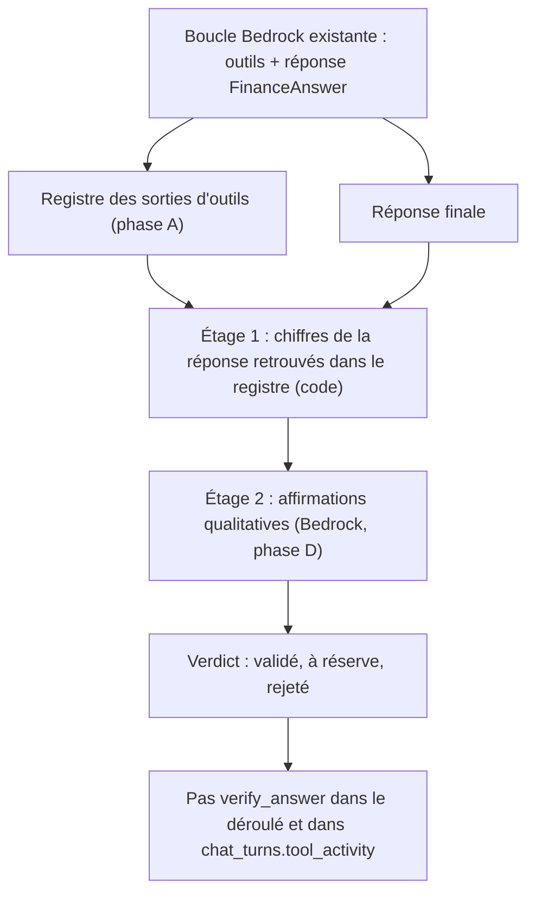

# Roadmap : agent vérificateur AlphaForge AI

Rédigée le 14 novembre 2026, sur la branche `agent-verificateur` (créée depuis `main` au commit `0dc7e38`, après la fusion de `agent-calcul`). Remise : dimanche 15 novembre à 23 h 59. Le déploiement est décrit dans [ROADMAP-DEPLOIEMENT.md](ROADMAP-DEPLOIEMENT.md). L'agent de calcul est décrit dans [ROADMAP-AGENT-CALCUL.md](ROADMAP-AGENT-CALCUL.md).

Légende : ✅ fait et vérifié · ⬜ à faire · ⚠️ à vérifier avant de s'y fier.

## 1. Objectif et portée

Après chaque réponse du chat, un second agent relit la réponse et contrôle que chaque chiffre vient d'un outil appelé pendant la même question. Il signale ce qui ne passe pas, et l'interface l'affiche.

> « Cette réponse contient-elle un chiffre que personne n'a calculé ni lu dans une source ? »

Le défi demande qu'un agent ait une raison d'exister et que l'on voie quelle vérification a influencé la réponse (`context/idees-datathon.md`). Le générateur de réponses n'a aujourd'hui qu'une consigne qui lui interdit d'inventer. Rien dans le code ne le contrôle.

| Critère du jury | Poids | Ce que le vérificateur apporte |
|---|---:|---|
| Agentique | 20 % | Un second agent avec un objectif distinct, dont le verdict est visible dans le déroulé |
| Données | 20 % | Une vérification capable de détecter une erreur, montrée en direct, et des cas de test chiffrés |
| Solution | 20 % | Une réponse dont on peut dire quels chiffres ont été contrôlés |
| AWS | 15 % | Amazon Bedrock sert aussi au contrôle des affirmations qualitatives (phase D) |

**Hors de la portée :** personas, ESG, Guardrails, agent de débat, graphique avant et après. Ils sont listés en section 8.

## 2. Ce qui existe et ce qu'il impose

Code : `backend-server/app/modules/chat/routes.py` (fonction `reply_events`), `backend-server/app/modules/analysis/tools.py`, `frontend-dashboard/src/app/api/finance-chat/route.ts`.

| Constat dans le code | Conséquence pour le vérificateur |
|---|---|
| Chaque appel d'outil produit une liste `evidence`, envoyée au modèle puis oubliée. Seuls `news`, `stock` et `portfolio` survivent jusqu'à l'événement `done`. | Il faut garder un registre de toutes les sorties d'outils de la question (phase A). |
| Les calculs ont un statut (`completed`, `partial`, `failed`) renvoyé avec chaque outil. | Le vérificateur peut exiger qu'un statut `partial` ou `failed` soit mentionné dans la réponse. |
| La réponse finale est une expression OpenUI `FinanceAnswer(title, explanation, headers, rows)`. | Les chiffres se trouvent dans `title`, `explanation` et `rows`. Il faut analyser cette expression, pas du texte libre. |
| `model_events` publie la réponse au fil de l'eau, dès que `root = FinanceAnswer(` apparaît. | Le contrôle ne peut pas précéder l'affichage sans changer le flux. Voir la décision D1. |
| Le serveur Next.js enregistre le déroulé des outils (`tool_activity`) avec la question et la réponse. | Un pas `verify_answer` dans le déroulé est enregistré sans migration de base de données. |
| Le déroulé n'affiche que les entrées des outils : `step["input"]` est filtré par une liste de clés. | Il faut ajouter un champ de sortie au pas d'activité pour afficher le verdict (phase C). |
| La question reçoit aussi des données de référence : `chart`, `previous_stock`, `previous_news`, les 10 échanges précédents. | Ces sources sont légitimes. Un chiffre qui vient d'elles ne doit pas être rejeté. |
| La boucle d'outils est limitée à 8 tours. | Le vérificateur s'exécute après la boucle, il ne consomme aucun tour. |

### 2.1 Formes des sorties d'outils (relevé de la phase A)

Chaque entrée du registre contient `evidence`, une liste de dictionnaires à une seule clé. La clé indique l'origine.

| Clé dans `evidence` | Outil | Contenu utile au contrôle | Unités et pièges |
|---|---|---|---|
| `Yahoo Finance` | `get_stock`, `compare_stocks`, `discover_companies` (avec période) | `price`, `previousClose`, `baseline`, `priceChange`, `percentChange`, `history.{firstClose, lastClose, high, low}`, `currency`, `asOf` | `percentChange` est déjà en pourcentage (3,2 veut dire 3,2 %). Les `points` du graphique sont retirés avant l'enregistrement. Les dates sont des chaînes ISO. |
| `StocksFeed coverage ranking` | `discover_companies` | `sector`, `hours`, `asOf`, liste `stocks` avec le nombre d'articles | Les nombres d'articles sont des entiers. |
| `signed-in portfolio` | `get_my_portfolio` | `positions` (quantité, cours, `value`, `dailyChange`, `weightPercent`), `totals` par devise avec `value`, `dailyChange`, `dailyPercent` | Totaux séparés par devise, jamais additionnés entre devises. `weightPercent` et `dailyPercent` en pourcentage. |
| `StocksFeed sources in citation order` | `search_news`, `get_my_portfolio` (vue news) | `stories` : titre, éditeur, date, résumé de 1 800 caractères au plus | Les nombres des résumés sont du texte. Un chiffre cité d'un article se trouve dans une chaîne, pas dans un champ numérique. |
| `AlphaForge calculation` | les six outils de calcul | Voir `analysis/tools.py` : `weightsPercent`, `sectorExposure.*.sectorsPercent`, `changeBySector.changePoints`, `concentration` (`herfindahl`, `effectiveLines`), `bySymbol.*` et `portfolio` de `risk_history` (`totalReturnPercent`, `annualizedVolatilityPercent`, `maxDrawdown.percent`), `portfolioValue.totalCAD`, `conversions` | Les champs en `...Percent` sont en pourcentage, `herfindahl` est un ratio entre 0 et 1, `changePoints` est en points de pourcentage. Les valeurs sont arrondies par l'outil (2 à 4 décimales). |
| `lookup unavailable`, `stock lookup unavailable`, `news lookup unavailable`, `portfolio news`, `unavailable` | tous | Entrée qui n'a pas abouti, avec les arguments | Pas de chiffre à retrouver. Le statut de l'enregistrement vaut `failed` ou `partial`. |

Conséquences pour la phase B :
- L'extraction des nombres doit parcourir une structure JSON quelconque, sans lire des champs choisis un par un. Elle garde le chemin de chaque nombre (par exemple `AlphaForge calculation → sectorExposure.after.sectorsPercent.technology`) pour nommer la source dans le verdict.
- Il faut aussi lire les nombres écrits dans les chaînes (résumés d'articles), mais les marquer comme source de type texte, moins fiable.
- Les nombres sont dans des unités variées (pourcentage, ratio, points, montant avec devise). Le verdict doit tenir compte de l'unité de la source.

## 3. Principe : un contrôle en deux étages

1. **Étage déterministe (code Python).** Extrait les nombres de la réponse et cherche chacun dans le registre des sorties d'outils. Gratuit, reproductible, ne se trompe pas d'un cas à l'autre.
2. **Étage Bedrock (second appel de modèle).** Lit la réponse et les sorties d'outils, puis juge ce que le code ne peut pas juger : causalité tirée d'un titre de presse, conseil déguisé, donnée manquante non signalée.

Le premier étage fait l'essentiel du travail et se démontre sans modèle. Le second est ce qui en fait un agent. On ne le présentera comme tel que s'il est réellement branché (phase D).

## 4. Décisions à prendre

| Décision | Options | Recommandation |
|---|---|---|
| **D1. Moment du contrôle** | (a) Après l'affichage : la réponse apparaît, puis le verdict s'ajoute. (b) Avant l'affichage : on retient la réponse finale, on la contrôle, puis on l'envoie. | Commencer par (a), qui ne change pas le flux continu. Passer à (b) seulement si la phase E (correction) est faite. Avec (b), la réponse arrive d'un bloc après le contrôle. |
| **D2. Que faire d'un chiffre rejeté** | (a) Seulement l'afficher. (b) Redemander une réponse au modèle avec la liste des chiffres rejetés, une seule fois. | (a) d'abord. (b) en phase E, avec une seule reprise pour borner le coût et la durée. |
| **D3. Modèle de l'étage 2** | Le même modèle que le chat (`BEDROCK_MODEL_ID`), ou un modèle plus petit configuré à part. | Le même modèle au début : aucune variable ni droit IAM nouveau. Un modèle séparé seulement si la durée devient gênante. |
| **D4. Où s'affiche le verdict** | Dans le déroulé existant, ou un badge sous la réponse. | Le déroulé d'abord (aucune migration). Le badge en phase C si le temps le permet. |

## 5. Les règles de contrôle

### Étage 1 : chiffres

| Règle | Détail |
|---|---|
| Nombres analysés | Pourcentages, montants, ratios, cours. Les nombres en tableau (`rows`) comme dans le texte. |
| Nombres ignorés | Références de sources (`[1]`), dates et heures, années, numéros de ligne, durées de période (« 5 ans », « 30 jours »), nombres écrits dans la question de l'utilisateur. |
| Correspondance | Un nombre de la réponse correspond à un nombre de la source si leurs valeurs coïncident après arrondi à la précision affichée. `26,3 %` correspond à `26.32`, mais `26,4 %` non. Les séparateurs français et anglais sont acceptés (`1 255`, `1,255`, `1.255`). |
| Unités | Un pourcentage s'apparie avec un pourcentage, un montant avec un montant de la même devise. `0,26` et `26 %` sont deux écritures du même nombre. |
| Valeurs dérivées | Une différence ou une somme de deux valeurs de la source (par exemple « +3,2 points ») est tolérée pour deux opérandes. Au-delà, elle est signalée comme `non retrouvé`. |
| Sources acceptées | Sorties d'outils de la question, puis données de référence transmises (`chart`, `previous_stock`, `previous_news`) et réponses précédentes du même fil. Le verdict nomme la source de chaque nombre retrouvé. |
| Verdict | `validé` : tous les nombres retrouvés. `à réserve` : nombres non retrouvés mais plausibles (valeur dérivée). `rejeté` : nombre sans aucune source. |

### Étage 2 : affirmations (phase D)

- Cause attribuée à un titre de presse ou à un mouvement de prix, alors que la consigne l'interdit.
- Formulation qui ressemble à un conseil d'achat ou de vente.
- Statut `partial` ou `failed` d'un outil non mentionné dans la réponse.
- Comparaison de séries de périodes ou de devises différentes sans l'avoir dit.

Le modèle renvoie un objet structuré (affirmation, règle enfreinte, citation de la réponse), pas un texte libre.

## 6. Phases

### Phase A : registre des preuves ✅
Réalisée le 14 novembre 2026.
- ✅ `backend-server/app/modules/verification/ledger.py` : `EvidenceLedger` et `ToolRecord` (identifiant d'appel, outil, statut, arguments, sorties). Chaque sortie est copiée par un aller-retour JSON : le registre garde ce que le modèle a reçu, même si l'objet d'origine change ensuite.
- ✅ `routes.py` : 3 lignes ajoutées dans `reply_events` (import, création du registre, `ledger.record(...)` juste avant l'envoi du statut final de l'outil). Ce que reçoit le modèle et les événements envoyés au navigateur ne changent pas.
- ✅ Formes des sorties relevées (section 2.1).
- ✅ Vérifié avec un faux client Bedrock : une question qui déclenche trois appels (un `get_stock` réussi, un `get_stock` au symbole invalide, un outil inconnu) laisse trois entrées dans le registre, avec les statuts `completed`, `failed` et `failed`. Les 13 tests existants passent.
- ⚠️ Non vérifié : un appel réel à Bedrock en mode flux continu. Le code ajouté est le même dans les deux modes, car il se trouve avant l'envoi du statut.
- ⚠️ Le registre n'est pas encore lu par personne. Il le sera en phase B.

**Critère de sortie :** atteint. Une entrée par appel d'outil, y compris pour les outils en échec.

### Phase B : étage déterministe ⬜
- ⬜ `verification/numbers.py` : lecture de l'expression `FinanceAnswer` (arguments positionnels JSON), extraction des nombres avec leur unité, règles d'ignorance de la section 5.
- ⬜ `verification/checks.py` : fonctions pures, sans réseau, qui comparent les nombres de la réponse au registre et renvoient un verdict par nombre.
- ⬜ Tests dans `backend-server/tests/test_verification.py` (cas de la section 7).

**Critère de sortie :** les tests passent, et la fonction renvoie le même verdict sur la réponse réelle d'une question de transfert enregistrée en local.

### Phase C : intégration et affichage ⬜
- ⬜ Dans `reply_events`, après la boucle d'outils, appeler le contrôle et émettre un pas d'activité `verify_answer` avec son statut (`completed`, `partial`, `failed`) et son verdict.
- ⬜ Étendre le pas d'activité d'un champ de sortie (nombres contrôlés, nombres non retrouvés), enregistré dans `tool_activity` comme le reste.
- ⬜ Frontend : libellé et affichage du verdict dans `activity-timeline.tsx`. Lister les nombres non retrouvés.
- ⬜ `ARCHITECTURE.md` et le README du backend (obligation de `AGENTS.md`). Le diagramme gagne une flèche du chat vers le vérificateur.
- ⬜ Vérifier que l'ancienne réponse déjà enregistrée s'ouvre toujours, sans pas `verify_answer`.

**Critère de sortie :** une question de transfert en local montre le pas `verify_answer` dans le déroulé, avec « validé » et le nombre de chiffres contrôlés. Une question simple (cours de MSFT) fonctionne toujours.

### Phase D : étage Bedrock ⬜
- ⬜ `verification/judge.py` : un appel `converse` avec la réponse, les sorties d'outils et les règles de la section 5. Sortie structurée, validée par Pydantic. Si la sortie est invalide, le verdict de l'étage 2 est `non évalué` et le contrôle de l'étage 1 reste affiché.
- ⬜ Limite de jetons et délai d'attente fixés. Une panne de Bedrock ne doit jamais empêcher la réponse d'arriver.
- ⬜ Le texte des articles reste traité comme non fiable, y compris dans cet appel.

**Critère de sortie :** une réponse qui attribue un mouvement à un titre de presse reçoit une réserve, et une réponse prudente passe.

### Phase E : correction et démonstration ⬜
- ⬜ Reprise unique (décision D2) : si le verdict est `rejeté`, renvoyer au générateur la liste des nombres sans source et demander une réponse corrigée. Le déroulé montre les deux tentatives.
- ⬜ Moyen de montrer une erreur détectée en direct, sans fausser le produit : un test automatisé qui altère une réponse, ou un mode de démonstration activé par variable d'environnement et jamais actif par défaut. À trancher avec l'équipe.
- ⬜ Décision D1 : passage à un contrôle avant affichage seulement si la reprise fonctionne et que la durée reste acceptable.

### Phase F : déploiement ⬜
- ⬜ Récupérer `main` avant la pull request (Ben y fusionne régulièrement).
- ⬜ Pull request de `agent-verificateur` vers `main`. Le merge déclenche le déploiement automatique (10 à 15 minutes, canary).
- ⬜ Aucune nouvelle variable ni nouveau droit IAM tant que le même modèle est utilisé (décision D3).
- ⬜ Tester une question de transfert sur l'URL publique, après la fin du déploiement.

## 7. Cas de test

| Cas | Résultat attendu |
|---|---|
| Réponse dont tous les nombres viennent de `simulate_transfer` | `validé` |
| Un pourcentage modifié (26,3 % devient 28,3 %) | Ce nombre est `non retrouvé`, verdict `rejeté` |
| Nombre arrondi (26,32 affiché 26,3 %) | Retrouvé |
| Séparateurs français (`1 255`, `26,3 %`) | Retrouvés |
| Référence `[1]`, date, « 5 ans » | Ignorés |
| Nombre qui ne figure que dans la question de l'utilisateur | Ignoré |
| Nombre qui ne figure que dans `previous_stock` | Retrouvé, source nommée |
| Différence entre deux valeurs de la source | `à réserve` (valeur dérivée) |
| Nombre de la réponse sans aucun outil appelé | `rejeté` |
| Outil en statut `partial`, réponse qui ne le mentionne pas | Réserve de l'étage 2 |
| Outil en échec, aucun chiffre dans la réponse | `validé`, sans nombre contrôlé |
| Réponse sans aucun nombre (conversation) | `validé`, 0 nombre contrôlé |
| Réponse non analysable (pas de `FinanceAnswer`) | `non évalué`, la réponse reste servie |

Cas de démonstration du jury, à rejouer avec le contrôle actif : transfert de 10 % → **26 %** et transfert de 5 % → **23 %** (voir la roadmap de l'agent de calcul).

## 8. Étapes suivantes, hors de la portée actuelle

- **Personas** (Amira, Mateo, Robert) : un champ `persona` transmis au modèle.
- **Étiquettes fait, hypothèse, scénario** sur chaque chiffre, qui s'appuieraient sur le registre du vérificateur.
- **Bedrock Guardrails** pour le blocage des conseils d'achat ou de vente.
- **Graphique avant et après** et bandeau « ce qui a changé ».
- **Agent de données et ESG** pour Mateo.

## 9. Risques

| Risque | Parade |
|---|---|
| Faux rejets : un nombre correct est écrit autrement que dans la source | Tests sur des réponses réelles avant la fusion, tolérance d'arrondi explicite, verdict `à réserve` plutôt que `rejeté` pour les valeurs dérivées |
| Faux validés : un nombre inventé coïncide avec un nombre de la source | Appariement par unité et par devise, et nom de la source dans le verdict pour que l'on puisse vérifier |
| Le contrôle ralentit la réponse | Étage 1 en quelques millisecondes. Étage 2 avec délai d'attente, et la réponse part sans lui s'il dépasse |
| Panne de Bedrock pendant le contrôle | La réponse est servie, le pas `verify_answer` indique `non évalué` |
| Conflits avec Ben dans `routes.py` | Module séparé, quelques lignes dans `routes.py`, récupération fréquente de `main` |
| Le format de sortie des outils change | Extraction générique des nombres dans le JSON, tests sur des sorties enregistrées |
| Annoncer un agent qui n'est que du code | Présenter l'étage 1 comme un contrôle et n'appeler « agent » que l'ensemble branché sur Bedrock (phase D) |
| Le rapport qui promet plus que ce qui est fait | Cocher une phase seulement après l'avoir essayée en local, avec une question réelle |
