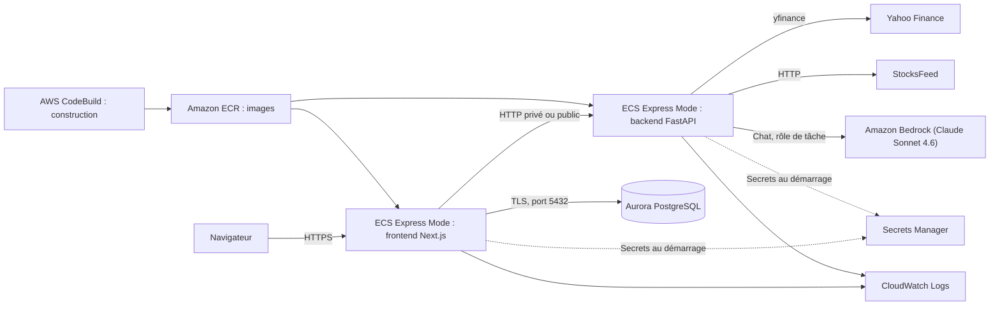

# Roadmap de déploiement AWS : AlphaForge AI

Rédigée le 14 novembre 2026. Elle décrit les étapes du déploiement et le rôle de chaque service AWS. Remise du dépôt et de l'application : dimanche 15 novembre à 23 h 59. Le compte d'équipe est supprimé le lundi 16 novembre.

Légende : ✅ fait et vérifié · ⬜ à faire · ⚠️ à vérifier avant de s'y fier.

## 1. Vue d'ensemble

| Service AWS | Rôle dans le projet | Phase |
|---|---|---|
| Amazon Aurora PostgreSQL | Comptes, sessions, portefeuilles (déjà en place) | 1 |
| Amazon ECR | Stocker les images Docker du frontend et du backend | 3 |
| AWS CodeBuild | Construire les images (Docker n'est pas installé dans l'environnement de travail) | 3 |
| AWS Secrets Manager | Mot de passe de la base, secret d'authentification, certificat | 4 |
| Amazon ECS Express Mode (Fargate) | Exécuter les deux conteneurs avec HTTPS et équilibreur de charge gérés | 5 |
| Amazon CloudWatch Logs | Journaux des deux services | 5 |
| Amazon Bedrock | Modèle du chat financier, appelé par le backend avec un rôle de tâche dédié | 5 ter |
| AWS CodeConnections | Accès de CodeBuild au dépôt GitHub, webhook sur `main` | 5 bis |

La couche d'agent de calcul (outils reproductibles, vérification des chiffres, personas) a sa propre roadmap : [ROADMAP-AGENT-CALCUL.md](ROADMAP-AGENT-CALCUL.md).

### Pourquoi ECS Express Mode et pas Amplify ou App Runner
- Amplify Hosting ne prend en charge que Next.js jusqu'à la version 15 selon [sa documentation](https://docs.aws.amazon.com/amplify/latest/userguide/ssr-amplify-support.html). Le projet est en Next.js 16.
- AWS App Runner n'accepte plus de nouveaux clients depuis le 30 avril 2026, et AWS recommande ECS Express Mode ([avis AWS](https://docs.aws.amazon.com/apprunner/latest/dg/apprunner-availability-change.html)).

## 2. Phases

### Phase 0 : vérifications préalables ✅ (sauf quotas)
- ✅ Les identifiants AWS sont disponibles dans l'environnement de travail (rôle de l'atelier, compte d'équipe).
- ✅ Le cluster Aurora `datathon` existe dans `us-east-1` (Aurora PostgreSQL 17.9, `available`, une instance Serverless v2).
- ✅ Le `DATABASE_HOST` configuré correspond à ce cluster.
- ✅ Le VPC par défaut contient 6 sous-réseaux publics, un par zone de disponibilité.
- ✅ Droits du rôle de l'atelier, simulés avec `iam:SimulatePrincipalPolicy` : autorisés pour ECR (création de dépôt, push), CodeBuild (projet, build), Secrets Manager (création), ECS (cluster, service, Express Mode), IAM (création de rôle, `PassRole`, attachement de politique), CloudWatch Logs, équilibreur de charge, règles du groupe de sécurité, et Bedrock (`Converse`, `InvokeModel`, `ApplyGuardrail`, `CreateGuardrail`, `InvokeTool`). Limite : la simulation ne prend pas en compte les politiques de contrôle de service (SCP) de l'organisation. Le premier appel réel de création le confirmera.
- ✅ État du compte (lectures réussies) : aucun cluster ECS, aucun projet CodeBuild, un dépôt ECR de démarrage CDK, trois secrets déjà présents (dont un nommé `polyfinance/bedroc…`, non lu). Aucun rôle d'exécution ECS n'existe : il faudra le créer.
- ✅ Bedrock, `us-east-1` : les modèles et profils d'inférence suivants sont listés : `us.amazon.nova-2-lite-v1:0` (modèle de Web Grounding), `us.amazon.nova-pro-v1:0`, `us.amazon.nova-premier-v1:0`, plusieurs profils Claude. Cette liste montre ce que le compte voit. L'accès réel a été confirmé ensuite pour `us.anthropic.claude-sonnet-4-6` (phase 5 ter).
- ⬜ Quotas : non vérifiés (Fargate, équilibreurs de charge).

**Critère de sortie :** une liste des services utilisables, ou la liste des blocages à lever avec un mentor AWS. Atteint, sous réserve des SCP.

### Phase 1 : base de données ✅
- ✅ Les tables `user`, `account`, `session`, `verification`, `rateLimit` et `portfolio_holdings` existent. La table `chat_turns` existe aussi, d'origine inconnue.
- ✅ Les migrations Better Auth et portefeuille ont été appliquées.
- ✅ La connexion TLS avec le bundle de certificats `us-east-1` (3 certificats) fonctionne et la vérification du certificat reste active.
- ⬜ Décider si le groupe de sécurité du cluster reste ouvert au port 5432 depuis `0.0.0.0/0` (état actuel). Pour un datathon c'est acceptable. Après la démonstration, restreindre l'accès aux services ECS.

### Phase 2 : conteneurisation ✅ (fichiers écrits, testés sans Docker)
- ✅ `backend-server/Dockerfile` : Python 3.12 slim, utilisateur non privilégié, `uvicorn app.main:app --host 0.0.0.0 --port 8000`. `STOCKSFEED_BASE_URL` a une valeur par défaut (l'adresse publique de l'exemple), que le service peut remplacer. Le `main.py` de développement (rechargement, `127.0.0.1`) n'est pas utilisé.
- ✅ `frontend-dashboard/Dockerfile` : trois étapes (dépendances, build, exécution) sur Node 24 slim. `HUSKY=0` évite le script `prepare`. Le serveur démarre avec `next start` sur `0.0.0.0:3000`, utilisateur `node`.
- ✅ Le build exige les variables de la base, car `src/lib/db.ts` les vérifie dès l'import du module. Le Dockerfile passe donc des valeurs factices (`build-placeholder`) à la seule commande `npm run build`. Elles ne sont pas stockées dans l'image ni utilisées à l'exécution.
- ✅ `.dockerignore` des deux applications : exclusion de `.env*` (sauf `.env.example`), de `node_modules`, `.venv`, `.next` et `.git`.
- ✅ `BACKEND_API_URL` et `BETTER_AUTH_URL` ne sont pas figées : elles viennent de l'environnement au démarrage.
- ✅ Vérifié en local, sans Docker : `npm run build` réussit avec les valeurs factices, aucune ne se retrouve dans `.next`, `next start` sert la page de connexion avec son CSS (HTTP 200), `/api/auth/get-session` répond `null` avec la base, et la redirection vers la connexion fonctionne. Le backend lancé avec la commande du conteneur répond sur `/docs`, `/stock/MSFT/history` et `/articles`.
- ⚠️ **Les images n'ont pas été construites** : Docker n'est pas installé dans l'environnement de travail. Le premier vrai test sera la construction dans CodeBuild (phase 3). Les étapes `COPY` et `npm prune --omit=dev` du Dockerfile frontend ne sont pas encore éprouvées.
- ⬜ Vérification de santé des services ECS : le backend n'a pas de route `/health`, utiliser `/docs`. Le frontend peut utiliser `/auth/v1/login`.

**Critère de sortie :** les deux images se construisent sans erreur et sans secret dans les couches. À confirmer en phase 3.

### Phase 3 : construction et registre ✅
Réalisé le 14 novembre 2026. Le code part dans un bucket S3 privé (archive `git archive` de la branche `deploiement`), et non depuis GitHub : CodeBuild n'a donc besoin d'aucun jeton GitHub.
- ✅ Dépôts ECR `polyfinance/backend` et `polyfinance/frontend` (analyse à chaque push activée).
- ✅ Bucket S3 `polyfinance-build-src-<compte>-us-east-1` : accès public bloqué, versionnement activé.
- ✅ Rôle IAM `polyfinance-codebuild-role` : journaux, push sur ces deux dépôts ECR, lecture du bucket.
- ✅ Projet CodeBuild `polyfinance-build` (image `aws/codebuild/standard:7.0`, mode privilégié pour Docker, calcul moyen), recette `deploy/buildspec.yml`. Les images de base viennent du miroir public d'AWS (`public.ecr.aws/docker/library`).
- ✅ Premier build réussi (construction 115 s, envoi 40 s). Images dans ECR, étiquette `24360fd` (hash du commit) : backend 118 Mo, frontend 480 Mo.
- ✅ Les Dockerfiles ont donc été éprouvés dans un vrai environnement Docker.

Pour reconstruire après une modification : produire l'archive (`git archive --format=zip -o source-<hash>.zip HEAD`), la déposer dans `s3://<bucket>/source/`, mettre à jour l'emplacement de la source et la variable `IMAGE_TAG` du projet, puis lancer un build. Un jeton GitHub ou CodeConnections éviterait ces gestes manuels, au prix d'un secret supplémentaire.

**Critère de sortie :** atteint. Les deux images sont dans ECR avec leur étiquette.

### Phase 4 : secrets ✅
Réalisé le 14 novembre 2026.
- ✅ Un seul secret JSON, `polyfinance/app`, dans Secrets Manager (`us-east-1`), avec six clés : `DATABASE_HOST`, `DATABASE_NAME`, `DATABASE_USER`, `DATABASE_PASSWORD`, `DATABASE_CA_CERT` et `BETTER_AUTH_SECRET`. Une tâche ECS peut référencer une clé précise du JSON.
- ✅ `BETTER_AUTH_SECRET` est un nouveau secret aléatoire de 32 octets, différent de celui du développement local.
- ✅ Les valeurs sont passées de `.env.local` à AWS par un script local, sans affichage. Elles n'apparaissent ni dans Git, ni dans un Dockerfile, ni dans les journaux.
- ✅ Vérifié : le secret contient les six clés, et une connexion TLS à Aurora réussit avec les valeurs qu'il contient. Le certificat (4 575 caractères) reste très en dessous de la limite de 128 Ko par variable d'environnement.
- ✅ Rôle d'exécution `polyfinance-ecs-execution-role` (approbation : `ecs-tasks.amazonaws.com`, limitée à ce compte). Politiques : `AmazonECSTaskExecutionRolePolicy` (lecture des images, écriture des journaux) et une politique en ligne qui autorise `secretsmanager:GetSecretValue` sur `polyfinance/app` uniquement. Simulation : lecture autorisée sur ce secret, refusée sur les autres.
- ✅ Les variables non secrètes (`DATABASE_PORT`, `BACKEND_API_URL`, `BETTER_AUTH_URL`, `STOCKSFEED_BASE_URL`) sont des variables d'environnement ordinaires (phase 5).
- ✅ Ajout ultérieur : la clé `CHAT_API_KEY` dans le même secret, qui compte désormais sept clés (phase 5 ter).

**Critère de sortie :** atteint. Le secret est lisible par le rôle d'exécution, et par lui seul.

### Phase 5 : services ECS Express Mode ✅
Réalisé le 14 novembre 2026, avec les images d'étiquette `24360fd`.
- ✅ Rôle d'infrastructure `polyfinance-ecs-infrastructure-role` (approbation : `ecs.amazonaws.com`, politique gérée `AmazonECSInfrastructureRoleforExpressGatewayServices`). Cluster ECS `polyfinance`. Groupes de journaux `/ecs/polyfinance-backend` et `/ecs/polyfinance-frontend` (conservation 7 jours).
- ✅ Service `polyfinance-backend` : port 8000, 0,5 vCPU et 1 Go, une tâche, vérification de santé `/docs`. URL publique : https://po-e59a191cd93e413aa245ac0c45f4c3e9.ecs.us-east-1.on.aws. Rollout terminé (`COMPLETED`).
- ✅ Service `polyfinance-frontend` : port 3000, 1 vCPU et 2 Go, une tâche, vérification de santé `/auth/v1/login`. URL publique : https://po-8688b8a9273e447c9c115ab93278e7fe.ecs.us-east-1.on.aws. Variables : `DATABASE_PORT`, `BACKEND_API_URL`, `BETTER_AUTH_URL`. Secrets lus dans `polyfinance/app` : les six clés de la phase 4.
- ✅ `BETTER_AUTH_URL` réglée sur l'URL exacte du frontend après sa création (mise à jour du service). Elle avait d'abord une valeur provisoire, car l'URL n'existe qu'après la création.
- ✅ Vérifié par requêtes : le backend répond (HTTP 200) sur `/docs`, `/stock/AAPL/history` et `/articles`. Le frontend répond (HTTP 200) sur `/auth/v1/login` et `/api/auth/get-session`. Les journaux du frontend montrent un démarrage de Next.js sans erreur.
- ✅ Vérifié dans un navigateur sur l'URL publique : connexion d'un compte de test, portefeuille avec deux titres (AAPL, AEE) et leurs cours. Le frontend joint donc le backend et lit le portefeuille dans Aurora depuis ECS.
- ✅ Les déploiements `IN_PROGRESS` s'expliquent par la stratégie de déploiement d'ECS Express Mode (voir phase 5 bis) et se sont terminés.
- ⚠️ Le premier essai de création du backend a échoué sur un droit du rôle d'infrastructure (`logs:DescribeLogGroups`), probablement un délai de propagation IAM : le second essai, quelques secondes plus tard, a réussi. À garder en tête si on recrée un service.
- ⚠️ Le groupe de sécurité d'Aurora reste ouvert au port 5432 depuis `0.0.0.0/0` (état de départ). Décision de le restreindre encore à prendre.
- ⚠️ Coût : les deux services (Fargate et équilibreur de charge) facturent à l'heure tant qu'ils tournent. À arrêter après la remise.

**Critère de sortie :** atteint. Un utilisateur se connecte et consulte son portefeuille sur l'URL publique du frontend.

### Phase 5 bis : redéploiement automatique ✅
Réalisé le 14 novembre 2026.
- ✅ Connexion AWS CodeConnections `polyfinance-github` (`us-east-1`), état `AVAILABLE`. L'application GitHub *AWS Connector for GitHub* doit avoir accès au dépôt `tarteeg/datathon-polyfinance` : c'est la cause de l'échec des premiers builds (`authorization failed for primary source`), réglée côté GitHub.
- ✅ Projet CodeBuild `polyfinance-build` : la source est maintenant le dépôt GitHub (via la connexion, clonage à profondeur 1), et non plus l'archive S3. Un seul build à la fois.
- ✅ `deploy/buildspec.yml` : après l'envoi des images, la recette relit la configuration de chaque service ECS et ne remplace que l'image. Les variables et les six secrets du frontend sont conservés (vérifié après le redéploiement). L'étiquette des images est le hash court du commit. La recette installe une version récente d'AWS CLI.
- ✅ Rôle de build : droits ajoutés pour la connexion (noms `codeconnections` et `codestar-connections`), la mise à jour des deux services, l'enregistrement des définitions de tâche et la transmission des deux rôles ECS.
- ✅ Test réussi depuis la branche `deploiement` : build du commit `8434b1b` (construction 137 s, envoi et mise à jour 43 s), images `8434b1b` dans ECR, deux services mis à jour, site toujours en ligne (HTTP 200 sur la connexion, la session, `/docs` et l'historique d'un titre).
- ✅ Webhook GitHub actif : chaque push sur `main` lance le build et le redéploiement.
- ✅ Fusion de `deploiement` dans `main` par la pull request #4 : `main` contient les Dockerfiles et `deploy/buildspec.yml`. Le premier déploiement automatique depuis `main` (commit `6961ddb`) a réussi.
- ✅ La branche `deploiement` est supprimée. La branche par défaut du projet CodeBuild, utilisée par les builds lancés à la main, est `main`.

#### Ce que le déploiement automatique fait, et ne fait pas
Tout push sur `main`, y compris le merge d'une pull request, reconstruit et redéploie les deux services. Les deux services sont reconstruits à chaque fois, même si un seul a changé.

**Durée et transition.** Compter 10 à 15 minutes entre le push et la fin du déploiement (mesuré le 14 novembre). ECS Express Mode déploie en **canary** : une petite part du trafic passe d'abord à la nouvelle version, puis 3 minutes d'observation précèdent la bascule complète. Pendant cette période, l'ancienne et la nouvelle version répondent toutes les deux, au hasard des requêtes. Ne pas tester ni enregistrer la vidéo pendant un déploiement.

Trois limites :
1. **Seul le code est déployé.** Les changements de base de données ne le sont pas : une nouvelle table ou une migration (`npm run auth:migrate`, `npm run portfolio:migrate`) se lance à la main. Une nouvelle variable d'environnement ou un nouveau secret s'ajoute aussi à la main au service ECS, car la recette ne change que l'image.
2. **La version publiée n'est pas garantie fonctionnelle.** Si la nouvelle version ne démarre pas ou échoue à la vérification de santé, ECS garde l'ancienne. Mais cette vérification ne teste que `/auth/v1/login` (frontend) et `/docs` (backend) : une page interne cassée serait mise en ligne.
3. **Pas d'étape de validation.** Aucun test ni relecture automatique n'est exécuté avant la mise en ligne. Éviter de fusionner juste avant l'enregistrement de la vidéo.
- ⬜ L'archive S3 et le bucket `polyfinance-build-src-…` ne servent plus. Ils peuvent être supprimés.

### Phase 5 ter : configuration du chat financier en ligne ✅
Réalisé le 14 novembre 2026. Le chat financier (pull request #3) appelle Amazon Bedrock depuis le backend. Le déploiement automatique ne change que l'image, donc sa configuration a été ajoutée à la main.
- ✅ Modèle : `us.anthropic.claude-sonnet-4-6` (profil d'inférence américain), appel test réussi depuis le compte.
- ✅ Secret : `CHAT_API_KEY` ajoutée à `polyfinance/app` (même valeur que dans les fichiers `.env` locaux des deux applications). Elle protège `POST /chat` : sans elle, le backend répond 403.
- ✅ Backend : variables `AWS_REGION=us-east-1` et `BEDROCK_MODEL_ID`, secret `CHAT_API_KEY`. Rôle de tâche `polyfinance-backend-task-role`, limité à `bedrock:InvokeModel` et `bedrock:InvokeModelWithResponseStream` sur ce profil d'inférence et ses modèles.
- ✅ Frontend : secret `CHAT_API_KEY` ajouté, autres variables et secrets conservés.
- ✅ Le jeton `AWS_BEARER_TOKEN_BEDROCK` des fichiers locaux n'est **pas** utilisé en ligne : le rôle de tâche le remplace, sans clé longue durée stockée dans AWS.
- ✅ Le rôle de build peut transmettre ce rôle de tâche, pour que les déploiements automatiques suivants ne bloquent pas.
- ✅ Table `chat_turns` : schéma déjà à jour dans Aurora (colonnes `thread_id`, `created_at`, `*_snapshot`), aucune migration lancée.
- ✅ Vérifié après la fin du déploiement : trois appels à `POST /chat` avec la clé réussissent (HTTP 200, environ 1 s), refus sans la clé.
- ⚠️ Les premiers essais dans le navigateur ont échoué (« The assistant is unavailable ») pendant le déploiement canary, quand l'ancienne version sans clé répondait encore. Ils ont réussi ensuite côté API. L'écran du chat reste à reconfirmer dans le navigateur.
- ⚠️ Ces réglages sont dans les services ECS, pas dans le code. Les déploiements automatiques les conservent, mais un service recréé devra les recevoir à nouveau.

**Critère de sortie :** une question posée dans l'écran du chat du site déployé reçoit une réponse. Atteint côté API, à confirmer dans le navigateur.

### Phase 6 : remise et sauvegarde ⬜
- ⬜ Enregistrer la vidéo d'environ cinq minutes pendant que le compte fonctionne.
- ⬜ Mettre à jour `ARCHITECTURE.md` et les README (obligation du fichier `AGENTS.md` quand le fonctionnement change).
- ⬜ Rédiger la documentation technique et la fiche d'une page avec le même cas que le prototype.
- ⬜ Pousser le code sur GitHub avant dimanche 23 h 59. Garder `.env.local` hors de Git.
- ⬜ Sauvegarder hors d'AWS : code, vidéo, secrets (gestionnaire de mots de passe), configuration des services.

## 3. Ordre et temps estimé

| Ordre | Phase | Durée indicative | Dépend de |
|---|---|---|---|
| 1 | 0 : vérifications | 15 min | Rien |
| 2 | 2 : Dockerfiles | 30 min | Rien |
| 3 | 3 : ECR et CodeBuild | 45 min | 0, 2 |
| 4 | 4 : secrets | 20 min | 0 |
| 5 | 5 : services ECS | 45 min | 3, 4 |
| 6 | 6 : remise | 2 à 3 heures | Tout, y compris l'agent de calcul |

Ces durées sont des estimations faites avant le travail, pas des mesures. L'agent de calcul, qui compte pour la note, suit sa propre roadmap ([ROADMAP-AGENT-CALCUL.md](ROADMAP-AGENT-CALCUL.md)). L'application peut aussi être démontrée en local pendant la vidéo.

## 4. Risques

| Risque | Parade |
|---|---|
| Droits IAM insuffisants (ECS Express, CodeBuild, rôles) | Phase 0 en lecture d'abord, demander un mentor AWS |
| Construction des images impossible sans Docker | CodeBuild, ou construction sur une autre machine |
| `BETTER_AUTH_URL` différent de l'URL publique | Mise à jour et redéploiement après la création du service |
| Frontend inaccessible derrière le proxy de l'IDE | Utiliser l'URL publique d'ECS, pas le lien `/proxy/3000` |
| Base ouverte à tout Internet | Restreindre aux services ECS après la démonstration |
| Secret dans Git ou dans une image | `.dockerignore`, `.gitignore` (`.env*`), Secrets Manager |
| Compte supprimé lundi | Sauvegarder code, vidéo et secrets dimanche |
| Coût imprévu (Fargate, équilibreur, appels Bedrock) | Une seule tâche par service, arrêter les services après la remise |
| Test ou vidéo pendant un déploiement canary | Attendre la fin du déploiement (10 à 15 min après un push sur `main`) |

## 5. Décisions

1. ✅ L'application a été déployée avant la couche d'agent de calcul.
2. ⬜ Garder ou restreindre l'ouverture du port 5432 sur le groupe de sécurité d'Aurora.
3. ✅ Backend public, sans authentification sauf `POST /chat` (clé partagée). Il ne sert que des données de marché publiques.
4. ✅ Branche `deploiement`, fusionnée dans `main` puis supprimée.
