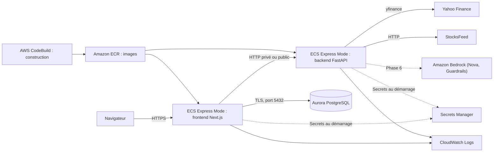

# Roadmap de déploiement AWS : AlphaForge AI

Rédigée le 14 novembre 2026. Elle décrit les étapes du déploiement et le rôle de chaque service AWS. Remise du dépôt et de l'application : dimanche 15 novembre à 23 h 59. Le compte d'équipe est supprimé le lundi 16 novembre.

Légende : ✅ fait et vérifié · ⬜ à faire · ⚠️ à vérifier avant de s'y fier.

## 1. Vue d'ensemble

| Service AWS | Rôle dans le projet | Phase |
|---|---|---|
| Amazon Aurora PostgreSQL | Comptes, sessions, portefeuilles (déjà en place) | 1 |
| Amazon ECR | Stocker les images Docker du frontend et du backend | 3 |
| AWS CodeBuild | Construire les images (Docker n'est pas installé dans l'environnement de travail) | 3 |
| AWS Secrets Manager | Mot de passe de la base, secret d'authentification, certificat | 4 |
| Amazon ECS Express Mode (Fargate) | Exécuter les deux conteneurs avec HTTPS et équilibreur de charge gérés | 5 |
| Amazon CloudWatch Logs | Journaux des deux services | 5 |
| Amazon Bedrock, Guardrails, Nova Web Grounding | Couche d'agent d'AlphaForge AI (critères AWS et Agentique du jury) | 6 |

### Pourquoi ECS Express Mode et pas Amplify ou App Runner
- Amplify Hosting ne prend en charge que Next.js jusqu'à la version 15 selon [sa documentation](https://docs.aws.amazon.com/amplify/latest/userguide/ssr-amplify-support.html). Le projet est en Next.js 16.
- AWS App Runner n'accepte plus de nouveaux clients depuis le 30 avril 2026, et AWS recommande ECS Express Mode ([avis AWS](https://docs.aws.amazon.com/apprunner/latest/dg/apprunner-availability-change.html)).

## 2. Phases

### Phase 0 : vérifications préalables ✅ (sauf quotas)
- ✅ Les identifiants AWS sont disponibles dans l'environnement de travail (rôle de l'atelier, compte d'équipe).
- ✅ Le cluster Aurora `datathon` existe dans `us-east-1` (Aurora PostgreSQL 17.9, `available`, une instance Serverless v2).
- ✅ Le `DATABASE_HOST` configuré correspond à ce cluster.
- ✅ Le VPC par défaut contient 6 sous-réseaux publics, un par zone de disponibilité.
- ✅ Droits du rôle de l'atelier, simulés avec `iam:SimulatePrincipalPolicy` : autorisés pour ECR (création de dépôt, push), CodeBuild (projet, build), Secrets Manager (création), ECS (cluster, service, Express Mode), IAM (création de rôle, `PassRole`, attachement de politique), CloudWatch Logs, équilibreur de charge, règles du groupe de sécurité, et Bedrock (`Converse`, `InvokeModel`, `ApplyGuardrail`, `CreateGuardrail`, `InvokeTool`). Limite : la simulation ne prend pas en compte les politiques de contrôle de service (SCP) de l'organisation. Le premier appel réel de création le confirmera.
- ✅ État du compte (lectures réussies) : aucun cluster ECS, aucun projet CodeBuild, un dépôt ECR de démarrage CDK, trois secrets déjà présents (dont un nommé `polyfinance/bedroc…`, non lu). Aucun rôle d'exécution ECS n'existe : il faudra le créer.
- ✅ Bedrock, `us-east-1` : les modèles et profils d'inférence suivants sont listés : `us.amazon.nova-2-lite-v1:0` (modèle de Web Grounding), `us.amazon.nova-pro-v1:0`, `us.amazon.nova-premier-v1:0`, plusieurs profils Claude. Cette liste montre ce que le compte voit. L'accès réel au modèle reste à confirmer par un premier appel (phase 6).
- ⬜ Quotas : non vérifiés (Fargate, équilibreurs de charge).

**Critère de sortie :** une liste des services utilisables, ou la liste des blocages à lever avec un mentor AWS. Atteint, sous réserve des SCP.

### Phase 1 : base de données ✅
- ✅ Les tables `user`, `account`, `session`, `verification`, `rateLimit` et `portfolio_holdings` existent. La table `chat_turns` existe aussi, d'origine inconnue.
- ✅ Les migrations Better Auth et portefeuille ont été appliquées.
- ✅ La connexion TLS avec le bundle de certificats `us-east-1` (3 certificats) fonctionne et la vérification du certificat reste active.
- ⬜ Décider si le groupe de sécurité du cluster reste ouvert au port 5432 depuis `0.0.0.0/0` (état actuel). Pour un datathon c'est acceptable. Après la démonstration, restreindre l'accès aux services ECS.

### Phase 2 : conteneurisation ✅ (fichiers écrits, testés sans Docker)
- ✅ `backend-server/Dockerfile` : Python 3.12 slim, utilisateur non privilégié, `uvicorn app.main:app --host 0.0.0.0 --port 8000`. `STOCKSFEED_BASE_URL` a une valeur par défaut (l'adresse publique de l'exemple), que le service peut remplacer. Le `main.py` de développement (rechargement, `127.0.0.1`) n'est pas utilisé.
- ✅ `frontend-dashboard/Dockerfile` : trois étapes (dépendances, build, exécution) sur Node 24 slim. `HUSKY=0` évite le script `prepare`. Le serveur démarre avec `next start` sur `0.0.0.0:3000`, utilisateur `node`.
- ✅ Le build exige les variables de la base, car `src/lib/db.ts` les vérifie dès l'import du module. Le Dockerfile passe donc des valeurs factices (`build-placeholder`) à la seule commande `npm run build`. Elles ne sont pas stockées dans l'image ni utilisées à l'exécution.
- ✅ `.dockerignore` des deux applications : exclusion de `.env*` (sauf `.env.example`), de `node_modules`, `.venv`, `.next` et `.git`.
- ✅ `BACKEND_API_URL` et `BETTER_AUTH_URL` ne sont pas figées : elles viennent de l'environnement au démarrage.
- ✅ Vérifié en local, sans Docker : `npm run build` réussit avec les valeurs factices, aucune ne se retrouve dans `.next`, `next start` sert la page de connexion avec son CSS (HTTP 200), `/api/auth/get-session` répond `null` avec la base, et la redirection vers la connexion fonctionne. Le backend lancé avec la commande du conteneur répond sur `/docs`, `/stock/MSFT/history` et `/articles`.
- ⚠️ **Les images n'ont pas été construites** : Docker n'est pas installé dans l'environnement de travail. Le premier vrai test sera la construction dans CodeBuild (phase 3). Les étapes `COPY` et `npm prune --omit=dev` du Dockerfile frontend ne sont pas encore éprouvées.
- ⬜ Vérification de santé des services ECS : le backend n'a pas de route `/health`, utiliser `/docs`. Le frontend peut utiliser `/auth/v1/login`.

**Critère de sortie :** les deux images se construisent sans erreur et sans secret dans les couches. À confirmer en phase 3.

### Phase 3 : construction et registre ⬜
- ⬜ Créer deux dépôts ECR (frontend et backend).
- ⬜ Créer un projet CodeBuild qui construit les images à partir du dépôt GitHub et les pousse dans ECR. ⚠️ À vérifier : l'accès de CodeBuild au dépôt privé (jeton GitHub ou connexion CodeConnections) et les droits du rôle.
- ⬜ Étiqueter les images avec le hash du commit, pas seulement `latest`.

**Critère de sortie :** les deux images sont visibles dans ECR avec leur étiquette.

### Phase 4 : secrets ⬜
- ⬜ Créer dans Secrets Manager : `DATABASE_HOST`, `DATABASE_NAME`, `DATABASE_USER`, `DATABASE_PASSWORD`, `BETTER_AUTH_SECRET`, `DATABASE_CA_CERT`.
- ⬜ Ne jamais écrire les valeurs dans Git, dans un Dockerfile ni dans les journaux.
- ⬜ Donner au rôle d'exécution des tâches ECS le droit de lire uniquement ces secrets.
- ⬜ Garder le certificat sous la limite de 128 Ko par variable d'environnement de Linux (le bundle `us-east-1` fait environ 4,5 Ko).

**Critère de sortie :** chaque secret est lisible par le rôle d'exécution, et par lui seul.

### Phase 5 : services ECS Express Mode ⬜
- ⬜ Créer le service backend à partir de l'image ECR. Port 8000. Variable `STOCKSFEED_BASE_URL`. Journaux dans CloudWatch.
- ⬜ Créer le service frontend. Port 3000. Variables : `BACKEND_API_URL` (URL du backend), `BETTER_AUTH_URL`, secrets de la phase 4.
- ⬜ Noter l'URL HTTPS générée pour le frontend, puis mettre `BETTER_AUTH_URL` à cette valeur exacte et redéployer. Sans cela, les connexions échouent.
- ⬜ Vérifier que les services joignent Aurora (la règle actuelle du groupe de sécurité l'autorise) et que le frontend joint le backend.
- ⬜ ⚠️ Vérifier le comportement d'ECS Express Mode dans ce compte (création du rôle d'infrastructure, équilibreur de charge, durée de création).

**Critère de sortie :** l'URL publique affiche la page de connexion avec son style, et un utilisateur peut s'inscrire, se connecter et ajouter un titre à son portefeuille.

### Phase 6 : couche d'agent AlphaForge AI ⬜
C'est elle qui rapporte les points sur les critères AWS (15 %) et Agentique (20 %). Détails dans `context/idees-datathon.md` et `context/VEILLE-TECHNOLOGIQUE.md`.
- ⬜ Premier appel `converse` à Amazon Bedrock depuis le backend, en `us-east-1`. ⚠️ Vérifier l'accès au modèle choisi dans le compte.
- ⬜ Route `/agent` avec un agent Strands, ses outils de calcul reproductibles et une trace des appels réels.
- ⬜ Vérification des chiffres en code : tout nombre de l'explication doit venir d'un outil.
- ⬜ Contextual grounding check de Bedrock Guardrails (`ApplyGuardrail`).
- ⬜ Encadré d'actualité avec Nova Web Grounding (régions américaines seulement, citations obligatoires).
- ⬜ Droits IAM du rôle de tâche du backend : `bedrock:InvokeModel` (ou Converse), `bedrock:ApplyGuardrail`, `bedrock:InvokeTool` pour Web Grounding.

**Critère de sortie :** le scénario de démonstration fonctionne de bout en bout sur l'URL publique, avec la trace et l'appel Bedrock visibles.

### Phase 7 : remise et sauvegarde ⬜
- ⬜ Enregistrer la vidéo d'environ cinq minutes pendant que le compte fonctionne.
- ⬜ Mettre à jour `ARCHITECTURE.md` et les README (obligation du fichier `AGENTS.md` quand le fonctionnement change).
- ⬜ Rédiger la documentation technique et la fiche d'une page avec le même cas que le prototype.
- ⬜ Pousser le code sur GitHub avant dimanche 23 h 59. Garder `.env.local` hors de Git.
- ⬜ Sauvegarder hors d'AWS : code, vidéo, secrets (gestionnaire de mots de passe), configuration des services.

## 3. Ordre et temps estimé

| Ordre | Phase | Durée indicative | Dépend de |
|---|---|---|---|
| 1 | 0 : vérifications | 15 min | Rien |
| 2 | 2 : Dockerfiles | 30 min | Rien |
| 3 | 3 : ECR et CodeBuild | 45 min | 0, 2 |
| 4 | 4 : secrets | 20 min | 0 |
| 5 | 5 : services ECS | 45 min | 3, 4 |
| 6 | 6 : agent Bedrock | plusieurs heures | 0, idéalement 5 |
| 7 | 7 : remise | 2 à 3 heures | Tout |

Ces durées sont des estimations, pas des mesures. Si le déploiement bloque, la phase 6 passe avant : l'agent et Bedrock comptent pour la note, l'hébergement non. L'application peut aussi être démontrée en local pendant la vidéo.

## 4. Risques

| Risque | Parade |
|---|---|
| Droits IAM insuffisants (ECS Express, CodeBuild, rôles) | Phase 0 en lecture d'abord, demander un mentor AWS |
| Construction des images impossible sans Docker | CodeBuild, ou construction sur une autre machine |
| `BETTER_AUTH_URL` différent de l'URL publique | Mise à jour et redéploiement après la création du service |
| Frontend inaccessible derrière le proxy de l'IDE | Utiliser l'URL publique d'ECS, pas le lien `/proxy/3000` |
| Base ouverte à tout Internet | Restreindre aux services ECS après la démonstration |
| Secret dans Git ou dans une image | `.dockerignore`, `.gitignore` (`.env*`), Secrets Manager |
| Compte supprimé lundi | Sauvegarder code, vidéo et secrets dimanche |
| Coût imprévu (Fargate, équilibreur, Bedrock, Web Grounding) | Une seule tâche par service, arrêter les services après la remise |

## 5. Décisions à prendre

1. Déployer l'application avant la couche d'agent, ou l'inverse (voir section 3).
2. Garder ou restreindre l'ouverture du port 5432 sur le groupe de sécurité d'Aurora.
3. Backend public (plus simple) ou privé (plus propre, demande plus de configuration réseau).
4. Branche Git pour les Dockerfiles et les scripts de déploiement.
